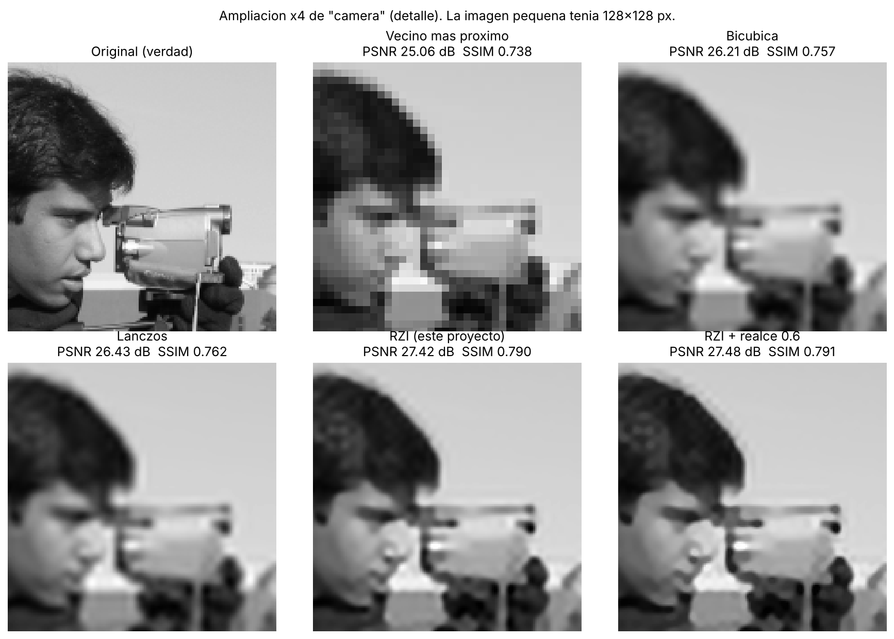

# RZI - Reconstructor de Zoom Iterativo

## Proyecto de Algoritmos Numericos - Universidad de Pamplona

Aplicacion de escritorio que amplia imagenes resolviendo una ecuacion diferencial parcial (Poisson) sobre la malla de pixeles, en lugar de usar solo interpolacion geometrica. El sistema lineal resultante se resuelve con **SOR Red-Black** sin construir la matriz (*matrix-free*) y acelerado con **Numba**.

No usa inteligencia artificial: no hay entrenamiento ni datos externos. Todo sale de la ecuacion y de los pixeles de la propia imagen.

**Documento de estudio completo (para la sustentacion):** [`docs/RZI_Documento_de_Estudio.pdf`](docs/RZI_Documento_de_Estudio.pdf)

## Resultados

Protocolo de verdad de campo: se reduce una imagen real por el factor indicado (bicubica con antialias) y se vuelve a ampliar con cada metodo. Promedio sobre 4 imagenes estandar de scikit-image (camera, astronaut, coffee, chelsea):

| Factor | Bicubica | Lanczos | **RZI** | Ganancia sobre bicubica |
|:---:|:---:|:---:|:---:|:---:|
| x2 | 30.90 dB | 31.30 dB | **32.16 dB** | +1.26 dB |
| x3 | 28.46 dB | 28.73 dB | **29.48 dB** | +1.02 dB |
| x4 | 27.00 dB | 27.25 dB | **28.05 dB** | +1.05 dB |

RZI mejora PSNR, SSIM y GMSD en las 12 combinaciones imagen/factor y supera a Lanczos en todas. Si la imagen se redujo con otro nucleo (Lanczos, desenfoque gaussiano, promedio de area), RZI sigue ganando, aunque menos (+0.5 a +0.8 dB). Es estable: con 30 ciclos sigue +0.96 dB por encima de la bicubica. Tablas completas en `docs/resultados/` y figuras en `docs/figuras/`.



**Con las 25 imagenes del equipo** (`imagenes_ejemplo/`: fotos, arte digital, radiografia), RZI gana a la bicubica y a Lanczos en las 25, en x2 (+1.59 dB de media) y en x4 (+0.99 dB), y tambien en SSIM y GMSD. Se reproduce con `python scripts/evaluar_imagenes.py`.

**Entrada con ruido o JPEG.** Si la imagen pequena trae ruido, la back-projection lo copiaba (con ruido de 0.02, RZI quedaba 1.8 dB por debajo de la bicubica). Ahora el ruido se mide en las zonas planas de la imagen completa y, si es claro (sigma > 0.013), se limpia antes con variacion total (modelo ROF): con ruido de 0.02 RZI queda +2.3 dB por encima de la bicubica. En imagenes limpias no se activa. El selector **Entrada** del panel permite forzar la limpieza de ruido leve o suavizar bloques de JPEG.

## El modelo

Se alternan dos pasos (10 ciclos por defecto):

1. **Back-projection** (consistencia con los datos): `t = u + Up(f - Down(u))`.
2. **Poisson "screened"** con gradientes reforzados en los bordes, resuelta con SOR Red-Black:

   `(4 + lam) u[i,j] - (suma de 4 vecinos) = -div(v)[i,j] + lam * t[i,j]`

   donde `v = s(|grad t|) grad t` y `s(x) = 1 + (beta_k - 1) x / (x + tau)`.

**Refuerzo decreciente:** en el ciclo k se usa `beta_k = 1 + (beta - 1) * rho^k` (por defecto beta = 1.8, rho = 0.93). Con refuerzo constante el efecto se acumulaba y con muchos ciclos la imagen se rompia (-5.6 dB de media con 30 ciclos); con refuerzo decreciente el refuerzo total queda acotado y el metodo es estable.

**Regiones grandes:** si la salida supera 4 MP se procesa por bloques de 256 px con 16 px de solape (mezclados con rampas lineales); el resultado coincide con el de la imagen completa. El maximo es 25 MP de salida: por encima, la aplicacion pide hacer zoom o bajar el factor.

La malla esta centrada en pixeles (la salida mide exactamente `h*k x w*k`). A color, la luminancia (Y) pasa por el modelo y la crominancia (Cb, Cr) por bicubica con back-projection.

**Omega optimo.** Se usa la formula de Young, `omega = 2 / (1 + sqrt(1 - rho_J^2))`. En el problema clasico con pixeles fijos dentro de la malla, `rho_J` se estima con el metodo de la potencia: la formula de malla completa (`2 / (1 + sin(pi/(n+1)))`) no aplica ahi y da casi 2, cuando el optimo real con factor 4 es cerca de 1.51 (20 iteraciones contra unas 350).

## Arquitectura (3 capas)

| Capa | Carpeta | Contenido |
|:---|:---|:---|
| Interfaz | `ui/` | Ventana PySide6, visores con zoom sincronizado, calculos en `QThread`. |
| Nucleo | `core/` | `poisson_builder.py` (problemas y omega), `sor_solver.py` (kernels SOR Red-Black con Numba), `upscaler.py` (modelo RZI), `image_ops.py` (reescalado y color en float64). |
| Servicios | `services/` | `metrics.py` (PSNR, SSIM, GMSD, nitidez, protocolo de degradacion), `exporter.py` (CSV y graficas), `diagnostico.py` (prueba cada herramienta). |

Ademas: `core/denoise.py` (estimacion de ruido y variacion total), `tests/` (33 pruebas automaticas), `scripts/evaluar_imagenes.py` (evaluacion con `imagenes_ejemplo/`), `scripts/generar_resultados.py` (reproduce tablas y figuras), `scripts/diagnostico.py` (revisa el entorno) y `docs/estudio/` (fuente del documento PDF).

## Instalacion y uso

Requisitos: Python 3.10 o superior.

```bash
python -m venv venv
```

```bash
source venv/bin/activate        # Windows: venv\Scripts\activate
```

```bash
pip install -r requirements.txt
```

```bash
python main.py
```

Tambien estan `instalar.sh` / `instalar.bat` y `ejecutar.sh` / `ejecutar.bat`. La primera ejecucion tarda unos segundos mas porque Numba compila los kernels y los guarda en cache.

### Uso (3 pasos, indicados arriba de los visores)

1. **Abrir imagen**: boton, arrastrar y soltar en la ventana, o *Archivo > Imagenes de ejemplo*.
2. **Zoom sobre la zona** con la rueda del mouse (arrastrar para moverse). Bajo los visores se ve el tamano de la region y de la salida, en naranja si se procesara por bloques y en rojo si es demasiado grande.
3. **Ampliar region (RZI)**: se abre un dialogo con zoom nativo, bicubica y RZI lado a lado (zoom sincronizado), con nitidez y consistencia de cada uno.

Herramientas:

- **Ver el proceso paso a paso:** animacion de cada etapa del metodo (lista de etapas a la izquierda; el ultimo cuadro es identico a "Ampliar region").
- **Lupa en tiempo real:** amplia x3 la zona bajo el cursor.
- **Medir calidad (comparar):** toma la region visible como verdad de campo (en fotos grandes, el recorte de 512 px con mas detalle), la reduce y la vuelve a ampliar con bicubica, Lanczos, RZI y RZI con realce. Muestra PSNR, SSIM, GMSD y nitidez; se puede exportar a CSV.
- **Barrido de omega:** curva de iteraciones contra omega, con el minimo medido, el omega estimado con la mascara y el de la formula de malla completa.
- **Benchmark Numba:** Numba contra Python puro haciendo exactamente el mismo trabajo.

Doble clic en cualquier grafica la abre en grande. Todos los calculos muestran progreso y se pueden cancelar.

**Calidad** (selector del panel izquierdo): *Mejor calidad* (recomendado), *Rapido* (vista previa) o *Bordes marcados* (agrega realce perceptual: bordes mas marcados a la vista, PSNR un poco menor). Los parametros finos estan en *Mostrar opciones avanzadas*.

### Si algo no funciona

Ningun error queda en silencio: se muestra un mensaje y el detalle se guarda en `rzi_errores.log` (junto a `main.py`; tambien en *Ayuda > Abrir registro de errores*). Para revisar el equipo:

```bash
python scripts/diagnostico.py
```

o *Ayuda > Diagnostico* dentro de la aplicacion. Prueba cada herramienta (calidad, barrido, benchmark, bloques) e imprime versiones y errores; comparta ese informe si algo falla.

### Pruebas y resultados

```bash
python -m pytest tests -q
```

```bash
python scripts/generar_resultados.py
```

```bash
bash docs/estudio/construir_pdf.sh
```

El ultimo comando regenera el PDF. Requiere pandoc y Node.js con Playwright/Chromium.

## Limitaciones

- No recupera detalle fino que desaparecio al reducir la imagen: mejora sobre todo los bordes.
- Supone un modelo de degradacion bicubico. Con otros la ganancia es menor.
- Las ganancias (0.6 a 1.7 dB sobre la bicubica) son reales pero moderadas: los metodos con redes neuronales logran mas, a costa de entrenamiento y de poder inventar detalle.

## Creditos

**Materia:** Algoritmos Numericos para Ingenieria (Corte 3)
**Universidad:** Universidad de Pamplona

**Equipo de desarrollo:**
- Anderson Fabian Gonzalez Aparicio
- Wilmer Sneyder Florez Peña
- Gonzalo Javier Niño Amaris
