# 1. Resumen en una pagina

<div class="caja">

**Como leer este documento.** Cada tema sigue el mismo orden: primero la idea intuitiva, despues la formula y al final un ejemplo o un dato medido. Si solo tiene una hora antes de la sustentacion, lea la seccion 1 (resumen), la seccion 9 (resultados), la seccion 11 (limitaciones) y la seccion 12 (preguntas probables). Todas las cifras de este documento salen de ejecutar `python scripts/generar_resultados.py` sobre el codigo actual, y se pueden reproducir.

</div>

**El problema.** Cuando se agranda una imagen digital hay que inventar los pixeles nuevos que aparecen entre los pixeles originales. Los metodos tipicos (vecino mas proximo, bicubica) o dejan bloques o dejan la imagen borrosa.

**La idea del proyecto.** En vez de rellenar los pixeles con una formula fija, se plantea una **ecuacion diferencial parcial (EDP)** sobre la malla de pixeles. Su solucion es una imagen grande que cumple dos condiciones a la vez:

1. si se vuelve a achicar, da exactamente la imagen pequena original (respeta los datos);
2. sus bordes son firmes (el campo de gradientes se refuerza en los bordes reales).

**El metodo numerico.** La EDP discretizada es un sistema lineal enorme y disperso ($Ax = b$, con cientos de miles de incognitas). Se resuelve con **SOR Red-Black** (sobre-relajacion sucesiva con ordenamiento de tablero de ajedrez), sin construir nunca la matriz (enfoque *matrix-free*), y compilado a codigo maquina con **Numba**.

**Resultados medidos** (4 imagenes estandar, factores x2, x3 y x4):

| Factor | Bicubica (PSNR) | Lanczos (PSNR) | **RZI (PSNR)** | Ganancia sobre bicubica |
|:---:|:---:|:---:|:---:|:---:|
| x2 | 30.90 dB | 31.30 dB | **32.17 dB** | **+1.27 dB** |
| x3 | 28.46 dB | 28.73 dB | **29.44 dB** | **+0.98 dB** |
| x4 | 27.00 dB | 27.25 dB | **28.01 dB** | **+1.01 dB** |

RZI tambien gana en SSIM (estructura) y en GMSD (bordes) en **todas** las imagenes y factores probados, y produce bordes visiblemente mas nitidos (seccion 9).

**Otros datos clave para la defensa:**

- El omega optimo calculado con la mascara real reduce las iteraciones del solver clasico de unas 350 a solo 20 (factor 4).
- Numba es unas 400 a 550 veces mas rapido que Python puro haciendo exactamente el mismo trabajo (la cifra exacta varia entre ejecuciones).
- No es inteligencia artificial: no hay entrenamiento ni datos externos. Todo sale de una ecuacion y de los pixeles de la propia imagen.

# 2. El problema del zoom

## 2.1 Que es una imagen digital

Una imagen en escala de grises es una tabla (matriz) de numeros. Cada numero es el brillo de un pixel: en este proyecto 0 es negro y 1 es blanco. Una imagen a color tiene tres tablas (rojo, verde y azul).

Agrandar una imagen por un **factor** $k$ significa pasar de $h \times w$ pixeles a $kh \times kw$ pixeles. Con $k = 4$, por cada pixel original aparecen 16 pixeles en la imagen grande: 1 que "conocemos" de forma aproximada y 15 que hay que inventar.

## 2.2 Las formas clasicas de rellenar

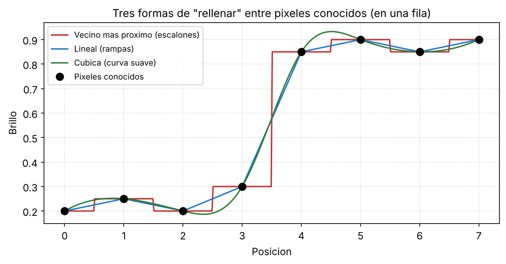{width=88%}

- **Vecino mas proximo:** cada pixel nuevo copia al original mas cercano. Es lo que hace el "zoom nativo" de un visor. Resultado: **bloques** (escalones).
- **Bilineal:** une los pixeles con rampas rectas. Sin bloques, pero borroso.
- **Bicubica:** une los pixeles con curvas suaves de grado 3. Es el estandar de la industria (Photoshop, navegadores). Sin bloques, pero los bordes quedan **suaves y borrosos**, porque una curva suave no puede representar un salto brusco.
- **Lanczos:** parecida a la bicubica, con un nucleo un poco mas "afilado".

Todas estas tecnicas miran solo unos pocos vecinos y aplican siempre la misma formula, haya un borde o no. **El objetivo de RZI es hacerlo mejor que la bicubica**, sobre todo en los bordes.

## 2.3 Por que no basta con "afilar" despues

Una idea tentadora es ampliar con bicubica y luego aplicar un filtro de nitidez (por ejemplo, la "mascara de enfoque" o *unsharp mask*). El problema es que esos filtros no saben cual era la imagen original: exageran el contraste de cualquier cosa, crean halos alrededor de los bordes y amplifican el ruido. La version anterior de este proyecto lo hacia y **bajaba el PSNR hasta 4 dB** respecto a no hacer nada (seccion 10). RZI, en cambio, mejora la nitidez **sin dejar de respetar** los datos originales.

# 3. De la imagen a una ecuacion

## 3.1 La ecuacion de Laplace: rellenar "lo mas suave posible"

Imagine una lamina de goma estirada sobre unos clavos de distinta altura. La goma toma la forma mas lisa posible entre los clavos. Matematicamente, esa forma cumple la **ecuacion de Laplace**:

$$\nabla^2 u = \frac{\partial^2 u}{\partial x^2} + \frac{\partial^2 u}{\partial y^2} = 0$$

En nuestra imagen, los "clavos" son los pixeles conocidos y la "goma" son los pixeles desconocidos.

## 3.2 La ecuacion de Poisson: rellenar siguiendo una guia

Si en vez de cero ponemos un termino del lado derecho, obtenemos la **ecuacion de Poisson**:

$$\nabla^2 u = g$$

El termino $g$ le dice a la solucion como debe curvarse en cada punto. Si $g$ es el laplaciano de una imagen guia $G$ (es decir, $g = \nabla^2 G$), la solucion "copia la forma" de la guia, pero respetando los valores de los pixeles conocidos. Esta idea se conoce como **edicion de imagenes en el dominio del gradiente** (Perez, Gangnet y Blake, 2003).

## 3.3 Discretizar: el estencil de 5 puntos

La computadora no maneja derivadas continuas, sino pixeles. La segunda derivada se aproxima con diferencias entre vecinos. Para un pixel $(i,j)$:

$$\nabla^2 u \approx u_{i-1,j} + u_{i+1,j} + u_{i,j-1} + u_{i,j+1} - 4\,u_{i,j}$$

Es decir: "la suma de los 4 vecinos menos 4 veces el centro". Si el pixel es igual al promedio de sus vecinos, el laplaciano es cero (zona lisa). Si es mas brillante que sus vecinos, el laplaciano es negativo (un pico).

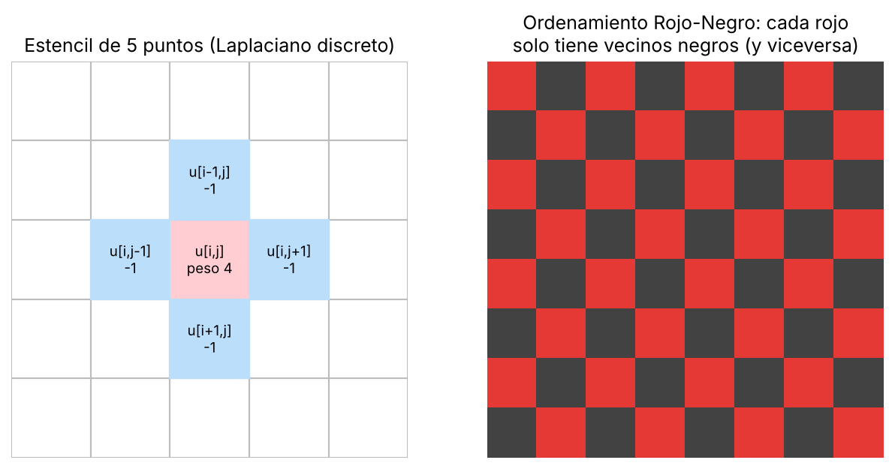{width=85%}

**Ejemplo numerico pequeno.** Si $u_{i-1,j} = 0.2$, $u_{i+1,j} = 0.4$, $u_{i,j-1} = 0.3$, $u_{i,j+1} = 0.3$ y $u_{i,j} = 0.5$, entonces el laplaciano es $0.2 + 0.4 + 0.3 + 0.3 - 4(0.5) = -0.8$: el pixel es un "pico" de brillo respecto a sus vecinos.

Escrita en la forma que usa el programa (multiplicando por $-1$), la ecuacion de Poisson en cada pixel desconocido es:

$$4\,u_{i,j} - u_{i-1,j} - u_{i+1,j} - u_{i,j-1} - u_{i,j+1} = b_{i,j}$$

con $b = -\nabla^2 G$. **Este signo menos es importante:** en la version anterior estaba invertido y por eso Poisson daba peor resultado que Laplace (seccion 10).

## 3.4 Condiciones de frontera de Dirichlet

Los pixeles conocidos no se calculan: tienen un valor fijo. A esto se le llama **condicion de frontera de Dirichlet**. En el problema didactico del proyecto se marca como conocido 1 de cada $k \times k$ pixeles, mas el borde de la imagen:

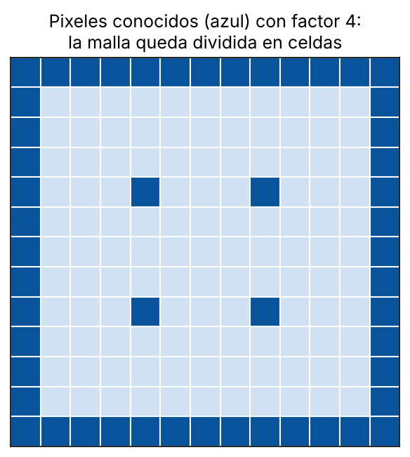{width=45%}

## 3.5 Un sistema lineal gigante y disperso

Una ecuacion por pixel desconocido da un **sistema lineal** $A\,u = b$. Para una imagen de $512 \times 512$ hay unas 262 000 incognitas, asi que $A$ tendria $262\,000 \times 262\,000 \approx 69$ mil millones de entradas. Guardada completa en `float64` ocuparia unos **550 GB**.

Pero cada fila de $A$ tiene como maximo 5 valores distintos de cero (el centro y sus 4 vecinos): la matriz es **dispersa**. Ademas es **simetrica y definida positiva**, lo que garantiza que el sistema tiene solucion unica y que los metodos iterativos de la seccion 4 convergen.

**Enfoque matrix-free.** El programa nunca construye $A$. Aplica el estencil de 5 puntos directamente sobre la imagen. La memoria usada es solo la de las imagenes: unos pocos MB.

# 4. Metodos iterativos

Resolver $Au = b$ por eliminacion de Gauss seria carisimo. Los **metodos iterativos** parten de una estimacion y la van corrigiendo hasta que el error es pequeno.

## 4.1 Jacobi

Despejando $u_{i,j}$ de la ecuacion del estencil:

$$u_{i,j}^{\text{nuevo}} = \frac{u_{i-1,j} + u_{i+1,j} + u_{i,j-1} + u_{i,j+1} + b_{i,j}}{4}$$

Jacobi calcula todos los valores nuevos usando solo los valores viejos. Es simple pero lento.

## 4.2 Gauss-Seidel

Igual que Jacobi, pero en cuanto un valor nuevo esta listo se usa de inmediato para los siguientes. Converge aproximadamente el doble de rapido que Jacobi.

## 4.3 SOR: sobre-relajacion sucesiva

SOR toma la correccion de Gauss-Seidel y la **exagera** un poco, multiplicandola por un factor $\omega$:

$$u_{i,j} \leftarrow u_{i,j} + \omega\,\left(u_{i,j}^{\text{GS}} - u_{i,j}\right)$$

- $\omega = 1$: es Gauss-Seidel.
- $1 < \omega < 2$: sobre-relajacion. Con el $\omega$ adecuado converge muchisimo mas rapido.
- $\omega \geq 2$: diverge.

Intuicion: si cada paso de Gauss-Seidel avanza en la direccion correcta pero se queda corto, conviene dar un paso un poco mas largo.

## 4.4 El residuo: como saber cuando parar

El **residuo** mide cuanto falla la ecuacion con la estimacion actual: $r = b - A\,u$. Si $u$ fuera la solucion exacta, $r$ seria cero. El programa para cuando el tamano del residuo (su norma) es menor que una **tolerancia**. En el modelo RZI se usa el residuo relativo $\lVert r \rVert / \lVert b \rVert$, que no depende del tamano de la imagen.

# 5. SOR Red-Black y el omega optimo

## 5.1 El ordenamiento Rojo-Negro

Si pintamos la malla como un tablero de ajedrez, cada pixel rojo solo tiene vecinos negros, y viceversa (figura de la seccion 3.3). Por lo tanto:

1. **Fase roja:** se actualizan todos los pixeles rojos. Ninguno depende de otro rojo, asi que se pueden calcular **todos a la vez**.
2. **Fase negra:** se actualizan todos los negros, usando los rojos recien calculados.

Esto conserva la velocidad de Gauss-Seidel/SOR y ademas permite **paralelizar** (usar varios nucleos del procesador) sin conflictos.

## 5.2 Radio espectral

Cada metodo iterativo se puede escribir como $e^{(k+1)} = M\,e^{(k)}$, donde $e$ es el error. Si el mayor autovalor de $M$ en valor absoluto, llamado **radio espectral** $\rho(M)$, es menor que 1, el error se encoge en cada iteracion. Cuanto mas pequeno es $\rho$, mas rapido converge.

## 5.3 La formula de Young

Para matrices como la nuestra (el estencil de 5 puntos con ordenamiento Rojo-Negro es "consistentemente ordenado"), David Young demostro en 1950 que el $\omega$ optimo depende solo del radio espectral de Jacobi, $\rho_J$:

$$\omega_{\text{opt}} = \frac{2}{1 + \sqrt{1 - \rho_J^{\,2}}}$$

Para una malla cuadrada de $n \times n$ puntos interiores **sin pixeles fijos dentro**, $\rho_J = \cos\!\left(\frac{\pi}{n+1}\right)$, y la formula se reduce a la clasica:

$$\omega_{\text{opt}} = \frac{2}{1 + \sin\!\left(\frac{\pi}{n+1}\right)}$$

## 5.4 Hallazgo: la formula clasica no aplica con mascara

La version anterior del proyecto usaba la formula clasica con $n$ igual al tamano de la imagen y afirmaba que el minimo de la curva de iteraciones coincidia "exactamente" con ella. **Lo medimos y no es asi.** Con 256 pixeles de lado la formula da $\omega \approx 1.98$, pero el minimo real estaba cerca de 1.52.

**Por que.** Los pixeles conocidos dentro de la malla (seccion 3.4) la parten en celdas pequenas de tamano $k \times k$. Un error no puede "viajar" lejos: queda atrapado en cada celda y se apaga rapido. Eso hace que $\rho_J$ sea mucho menor que el de la malla completa, y por tanto que el $\omega$ optimo tambien sea menor.

**Solucion implementada.** El programa calcula $\rho_J$ del problema real (con la mascara) mediante el **metodo de la potencia**: aplica el operador de Jacobi muchas veces a un vector aleatorio y mide cuanto se encoge. Con ese $\rho_J$ aplica la formula de Young.

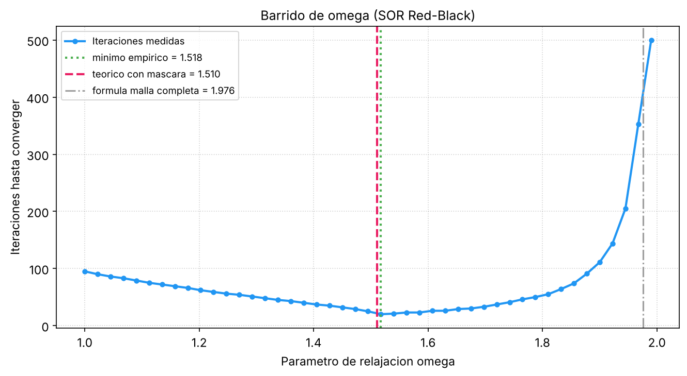{width=85%}

| Factor | Formula malla completa | Estimado con mascara | Minimo medido | Iteraciones (estimado) | Iteraciones (malla completa) |
|:---:|:---:|:---:|:---:|:---:|:---:|
| 2 | 1.976 | 1.171 | 1.180 | 8 | 370 |
| 3 | 1.976 | 1.374 | 1.383 | 14 | 359 |
| 4 | 1.976 | 1.510 | 1.518 | 20 | 353 |
| 6 | 1.976 | 1.667 | 1.675 | 31 | 345 |
| 8 | 1.976 | 1.751 | 1.765 | 54 | 341 |

Con el omega correcto, el solver hace **entre 6 y 46 veces menos iteraciones**. Este es un buen ejemplo de pensamiento critico para la sustentacion: una formula correcta aplicada fuera de sus hipotesis da un resultado incorrecto.

# 6. El modelo RZI de ampliacion {.salto}

Esta es la parte central del proyecto. Las secciones 3 a 5 explican las herramientas; aqui se combinan para ampliar imagenes mejor que la bicubica.

## 6.1 Paso 1: modelo de degradacion y back-projection

Pensamos asi: la imagen pequena $f$ se obtuvo achicando una imagen grande desconocida $u$. Llamamos **Down** a la operacion de achicar (promediar con un nucleo bicubico) y **Up** a la de agrandar con bicubica. Queremos una $u$ tal que:

$$\text{Down}(u) \approx f$$

La **back-projection** (Irani y Peleg, 1991) corrige la estimacion con el error que queda al achicarla:

$$t = u + \text{Up}\big(f - \text{Down}(u)\big)$$

Si $\text{Down}(u)$ ya es igual a $f$, la correccion es cero. Si no, se suma la diferencia ampliada. Es un metodo iterativo en si mismo, parecido a Jacobi: corrige con el residuo.

**Problema:** la back-projection sola recupera detalle, pero tambien crea pequenas ondas junto a los bordes (*ringing*). Hace falta un segundo paso que regularice.

## 6.2 Paso 2: Poisson "screened" con gradientes reforzados

Buscamos la imagen $u$ que minimiza una **energia** con dos terminos:

$$E(u) = \lambda \sum_{\text{pixeles}} (u - t)^2 \;+\; \sum_{\text{pixeles}} \lVert \nabla u - \mathbf{v} \rVert^2$$

- El primer termino dice: "no te alejes de $t$" (la estimacion corregida). $\lambda$ es su peso.
- El segundo dice: "ten los gradientes (bordes) que indica el campo $\mathbf{v}$".

Igualando a cero la derivada de $E$ respecto a cada pixel (la condicion de minimo, llamada ecuacion de **Euler-Lagrange**) se llega a:

$$(4 + \lambda)\,u_{i,j} - u_{i-1,j} - u_{i+1,j} - u_{i,j-1} - u_{i,j+1} = -\operatorname{div}(\mathbf{v})_{i,j} + \lambda\,t_{i,j}$$

Es la misma ecuacion de Poisson de la seccion 3, con un $\lambda$ sumado en la diagonal. Por eso se llama **Poisson apantallada** (*screened Poisson*). El $\lambda$ hace la matriz "mas diagonal", y por eso converge todavia mas rapido. Se resuelve con el mismo SOR Red-Black, con:

$$\rho_J = \frac{2\cos\!\left(\frac{\pi}{m+1}\right) + 2\cos\!\left(\frac{\pi}{n+1}\right)}{4 + \lambda}$$

**El campo de gradientes reforzado.** $\mathbf{v}$ es el gradiente de $t$ (ligeramente suavizado para no reforzar ruido), multiplicado por un factor que crece con la fuerza del borde:

$$\mathbf{v} = s\big(\lVert \nabla t \rVert\big)\,\nabla t, \qquad s(x) = 1 + (\beta - 1)\,\frac{x}{x + \tau}$$

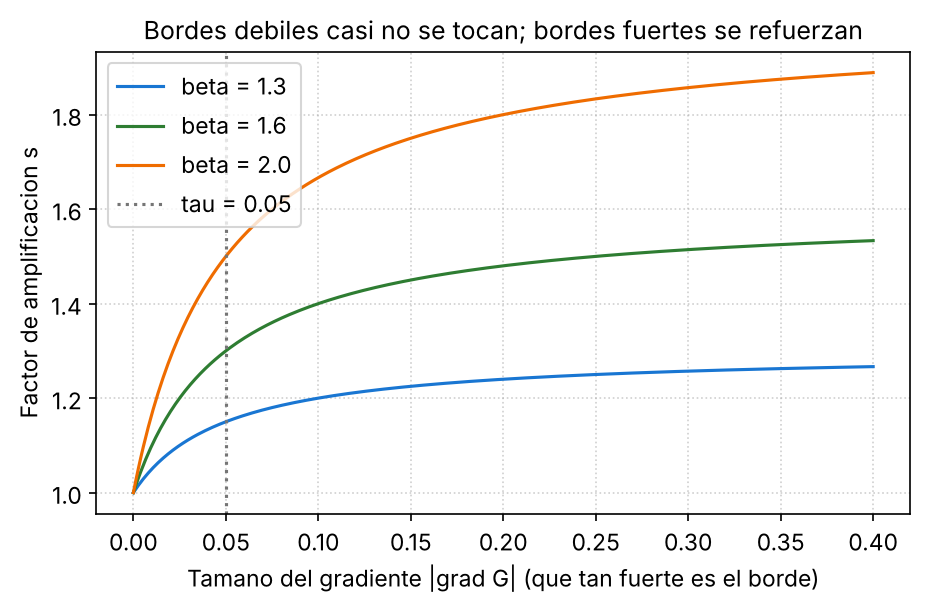{width=72%}

## 6.3 El ciclo completo

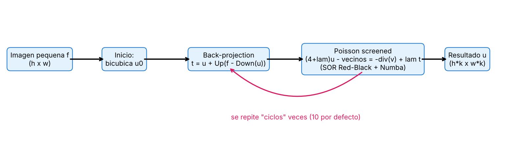{width=100%}

1. Empezar con la ampliacion bicubica $u_0$, de tamano exacto $kh \times kw$.
2. Repetir 10 veces (los "ciclos"): back-projection para obtener $t$, y luego resolver la Poisson screened con SOR Red-Black.
3. Terminar con 5 pasadas de back-projection, para que $\text{Down}(u)$ coincida con $f$ casi exactamente.

Los valores por defecto ($\lambda = 0.3$, $\beta = 1.6$, $\tau = 0.05$, $\sigma = 0.6$, 10 ciclos) se eligieron midiendo la calidad promedio sobre las 4 imagenes de prueba en x2, x3 y x4. Los dos pasos se ayudan: la back-projection aporta la fidelidad a los datos y la EDP aporta bordes limpios sin ondas.

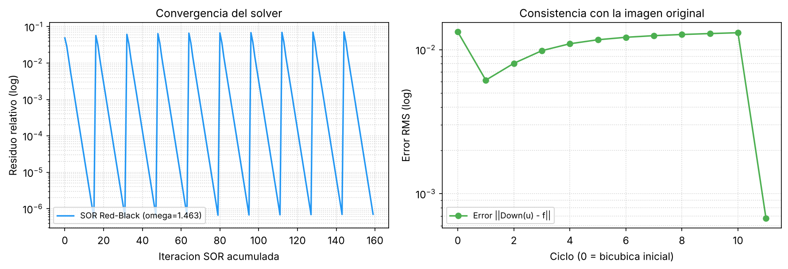{width=95%}

## 6.4 Malla centrada en pixeles

Un detalle tecnico que hacia mucho dano en la version anterior: la malla estaba "alineada por esquinas" y medía $(h-1)k + 1$ en vez de $hk$. Por ejemplo, una imagen de 32 pixeles ampliada x4 daba 125 pixeles en vez de 128, y habia que **estirarla** al final, lo que desplazaba y emborronaba todo. Ahora la salida mide exactamente $hk \times wk$.

## 6.5 Imagenes a color

El ojo humano percibe la nitidez sobre todo en el **brillo** (luminancia) y mucho menos en el color. Por eso:

1. se convierte RGB a **YCbCr** (Y = brillo, Cb y Cr = color), en `float64` para no perder precision;
2. el canal Y pasa por el modelo RZI completo;
3. Cb y Cr se amplian con bicubica mas back-projection, que es barato;
4. se vuelve a RGB.

## 6.6 Realce perceptual (opcional)

La aplicacion incluye un control de "realce perceptual" (de 0 a 1, apagado por defecto). Aplica una mascara de enfoque controlada: recorta al rango local para no crear halos y despues reproyecta para no perder fidelidad. Marca mas los bordes a la vista, pero baja un poco el PSNR (unos 0.1 a 0.2 dB). Esta apagado por defecto porque **el objetivo principal es ser fiel a la imagen real**. Se puede mostrar en la sustentacion como opcion visual, aclarando ese costo.

# 7. Aceleracion con Numba

## 7.1 Por que Python puro es lento

Python interpreta cada operacion una por una: para una malla de $256 \times 256$ el bucle de SOR ejecuta cientos de miles de operaciones por iteracion, cada una con su sobrecosto de interpretacion.

## 7.2 Que hace Numba

Numba es un compilador **JIT** (*just in time*, "justo a tiempo"). Al decorar una funcion con `@njit`, la primera vez que se llama la traduce a codigo maquina nativo (via LLVM) y la guarda en cache (`cache=True`). A partir de ahi corre a la velocidad de C.

- `parallel=True` con `prange`: reparte las filas entre los nucleos del procesador. Es seguro gracias al ordenamiento Rojo-Negro (seccion 5.1).
- `fastmath=True`: permite reordenar operaciones de punto flotante para ganar velocidad.

## 7.3 Benchmark justo

La version anterior comparaba Numba (que ademas calculaba el residuo) contra un bucle de Python que no lo calculaba. Ahora **ambos hacen exactamente el mismo trabajo**: 20 iteraciones completas con fase roja, fase negra y residuo, sin criterio de parada. Tambien se verifica que den el mismo resultado (diferencia maxima menor que $10^{-10}$).

| Malla | Python puro | Numba | Aceleracion |
|:---:|:---:|:---:|:---:|
| 64 x 64 | 0.108 s | 0.00020 s | 541 veces |
| 128 x 128 | 0.506 s | 0.00094 s | 538 veces |
| 256 x 256 | 1.665 s | 0.00421 s | 395 veces |

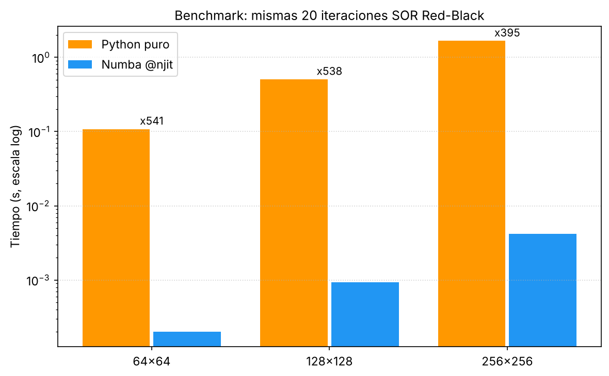{width=70%}

Los tiempos dependen del computador. En la sustentacion conviene correr el benchmark en vivo desde la aplicacion.

# 8. Como se mide la calidad

## 8.1 El protocolo de verdad de campo

Para saber si una ampliacion es buena necesitamos saber como "deberia" verse. Por eso se usa este protocolo (el estandar en la literatura de super-resolucion):

1. Se toma una imagen real de buena calidad: la **verdad de campo**.
2. Se achica a proposito por el factor $k$ (bicubica con antialias).
3. Cada metodo amplia la imagen pequena de vuelta al tamano original.
4. Se compara cada resultado con la verdad de campo.

## 8.2 Las metricas, explicadas sencillo

- **PSNR** (relacion senal a ruido de pico, en dB): mide el error pixel a pixel. $\text{PSNR} = 10 \log_{10}\!\left(\frac{1}{\text{MSE}}\right)$, donde MSE es el error cuadratico medio. **Mayor es mejor.** Una ganancia de 1 dB equivale a reducir el error cuadratico en un 21 %.
- **SSIM** (similitud estructural, de 0 a 1): compara brillo, contraste y forma en ventanas pequenas, de modo parecido a como mira el ojo. **Mayor es mejor.**
- **GMSD** (desviacion de la similitud de magnitud de gradiente): compara los mapas de bordes. **Menor es mejor.** Es la metrica mas sensible a la nitidez.
- **Nitidez** (magnitud media del gradiente): no necesita verdad de campo. Ojo: por si sola puede enganar, porque los bloques del vecino mas proximo tambien tienen gradientes grandes. Por eso se mira junto con las demas.
- **Consistencia** (modo Reconstruir): PSNR entre la imagen ampliada vuelta a achicar y la original. Mide si la ampliacion respeta los datos reales.

# 9. Resultados {.salto}

## 9.1 Tabla completa (degradacion bicubica)

| Imagen | Factor | Bicubica PSNR / SSIM | Lanczos PSNR | **RZI PSNR / SSIM** | GMSD bic. / **RZI** |
|:---|:---:|:---:|:---:|:---:|:---:|
| camera | x2 | 29.90 / 0.873 | 30.23 | **30.95 / 0.898** | 0.114 / **0.088** |
| camera | x3 | 27.69 / 0.809 | 27.98 | **28.83 / 0.837** | 0.169 / **0.139** |
| camera | x4 | 26.21 / 0.757 | 26.43 | **27.40 / 0.791** | 0.203 / **0.175** |
| astronaut | x2 | 30.43 / 0.947 | 30.93 | **32.09 / 0.960** | 0.089 / **0.073** |
| astronaut | x3 | 27.39 / 0.897 | 27.76 | **28.74 / 0.918** | 0.138 / **0.119** |
| astronaut | x4 | 25.57 / 0.843 | 25.91 | **27.02 / 0.877** | 0.167 / **0.148** |
| coffee | x2 | 29.26 / 0.885 | 29.66 | **30.59 / 0.916** | 0.105 / **0.074** |
| coffee | x3 | 27.07 / 0.808 | 27.29 | **27.97 / 0.843** | 0.165 / **0.134** |
| coffee | x4 | 25.97 / 0.752 | 26.14 | **26.77 / 0.788** | 0.196 / **0.171** |
| chelsea | x2 | 34.02 / 0.921 | 34.37 | **35.04 / 0.942** | 0.083 / **0.064** |
| chelsea | x3 | 31.67 / 0.860 | 31.88 | **32.22 / 0.883** | 0.132 / **0.113** |
| chelsea | x4 | 30.28 / 0.808 | 30.53 | **30.86 / 0.834** | 0.161 / **0.145** |

RZI gana en las 12 combinaciones y en las tres metricas. La ganancia va de +0.55 dB (chelsea x3, una imagen muy suave con poco detalle que recuperar) a +1.66 dB (astronaut x2). Tiempo tipico: entre 0.1 y 0.5 s por imagen de 512 x 512 en un computador comun.

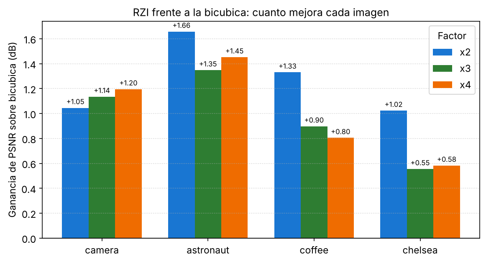{width=85%}

## 9.2 Lo que se ve

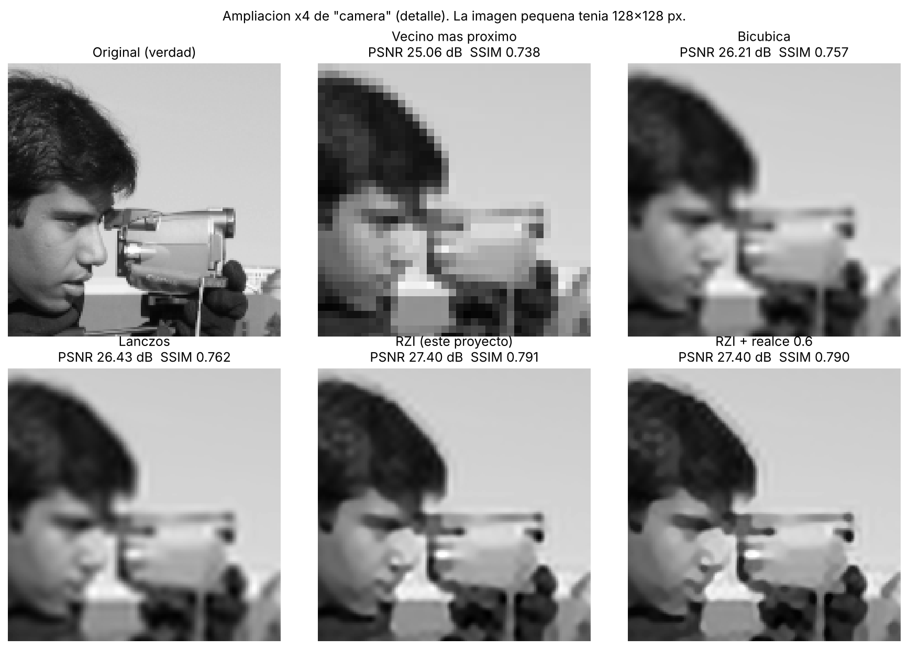{width=100%}

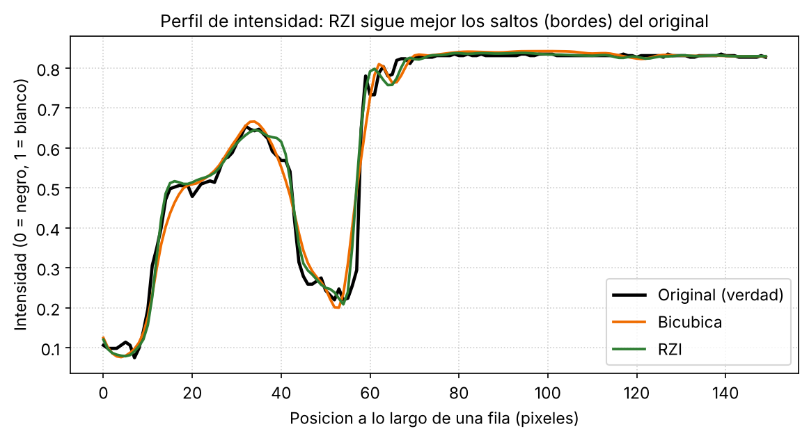{width=85%}

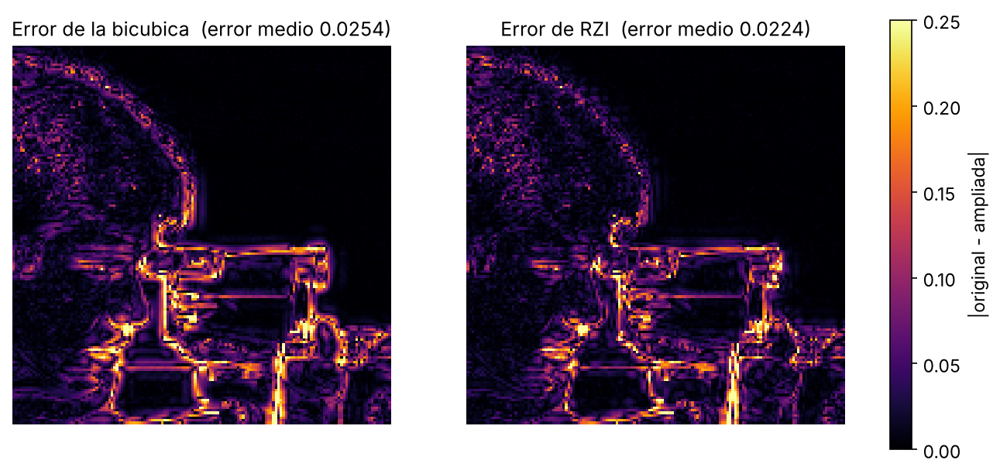{width=90%}

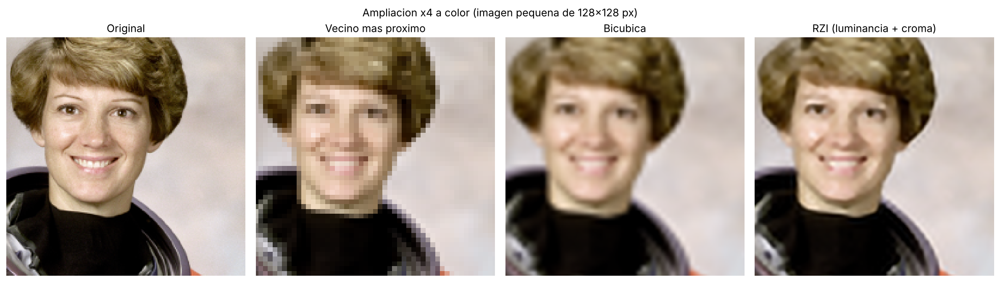{width=100%}

## 9.3 Robustez: y si la imagen no se achico con bicubica

El modelo supone que la imagen pequena se obtuvo con un nucleo bicubico (el operador Down). En la vida real no siempre es asi. Probamos otras formas de achicar (promedio de 8 casos: 4 imagenes, factores x2 y x4):

| Como se achico la imagen | Ganancia media sobre bicubica | Peor caso |
|:---|:---:|:---:|
| Bicubica (lo que supone el modelo) | +1.14 dB | +0.58 dB |
| Lanczos | +0.80 dB | +0.29 dB |
| Desenfoque gaussiano + submuestreo | +0.66 dB | +0.40 dB |
| Promedio de area (box) | +0.40 dB | +0.04 dB |

Conclusion honesta: RZI **sigue ganando** aunque el modelo de degradacion no sea exacto, pero gana menos. Esto es esperable y conviene decirlo en la sustentacion.

# 10. Errores encontrados y corregidos

Esta seccion es material valioso para la defensa: muestra que el equipo **verifico** su propio trabajo con datos.

| Problema en la version anterior | Como se detecto | Correccion | Efecto |
|:---|:---|:---|:---|
| Signo de $b$ invertido en Poisson | Poisson daba peor que Laplace (35.75 contra 38.09 dB) | $b = -\nabla^2 G$ | Poisson pasa a 39.61 dB |
| Formula de omega fuera de sus hipotesis | Barrido: teorico 1.95, minimo real 1.52 | Metodo de la potencia + Young | De 353 a 20 iteraciones |
| Malla alineada por esquinas, $(h-1)k+1$ | Salidas de 125 px en vez de 128 | Malla centrada, salida $hk$ | Sin estiramiento ni desalineacion |
| Filtros shock + difusion + USM despues del solver | Medimos PSNR por etapa: hasta -4 dB | Back-projection + Poisson screened | De peor que bicubica a +1 dB mejor |
| Benchmark desigual | Numba hacia mas trabajo que Python | Mismo trabajo en ambos | Comparacion valida |
| CSV exportado vacio | Filtro buscaba "Poisson" en los nombres | Marca `es_rzi` en cada fila | CSV completo |
| Modulo `metodos/` roto | `import metodos` fallaba | Eliminado | Repositorio limpio |
| Visor suavizaba el zoom | El zoom nativo no mostraba bloques | Vecino mas proximo al acercar | Se ven los pixeles reales |
| Dos hilos llamando a Numba paralelo | Riesgo de cierre del programa | Candado (lock) en los kernels | Lupa y calculo seguros |

Todo esto esta cubierto por pruebas automaticas (`python -m pytest tests`, 15 pruebas).

# 11. Limitaciones (decirlas antes de que las pregunten)

1. **No inventa detalle que no existe.** Si una textura fina (pelo, letras pequenas) desaparecio al achicar, ningun metodo basado solo en la imagen puede recuperarla de forma exacta. RZI reconstruye mejor los **bordes**, no detalles perdidos.
2. **Supone un modelo de degradacion.** Funciona mejor cuando la imagen se achico de forma parecida a la bicubica (seccion 9.3).
3. **Ganancias moderadas.** Entre 0.5 y 1.7 dB sobre la bicubica es una mejora real y medible, pero no es "magia". Los metodos de inteligencia artificial (redes neuronales entrenadas con millones de imagenes) logran mas en PSNR o en apariencia, a costa de necesitar entrenamiento, GPU y de poder "alucinar" detalle falso.
4. **Ruido.** Si la imagen pequena tiene mucho ruido, la back-projection lo respeta como si fuera informacion real.
5. **Parametros ajustados en pocas imagenes.** Se eligieron con 4 imagenes estandar; otras imagenes podrian preferir otros valores.

# 12. Guia de sustentacion {.salto}

## 12.1 Guion de demostracion (unos 10 minutos)

1. **(1 min) El problema.** Abrir una foto, hacer zoom con la rueda en el visor izquierdo hasta ver los bloques. "Esto es el zoom nativo: vecino mas proximo."
2. **(2 min) Reconstruir.** Pulsar *Reconstruir (RZI)*. En el dialogo, hacer zoom (los tres visores se mueven juntos) y comparar vecino, bicubica y RZI. Senalar la nitidez y la consistencia.
3. **(2 min) Comparar modelos.** Alejar el zoom, pulsar *Comparar modelos*. Leer la tabla: PSNR, SSIM y GMSD de bicubica, Lanczos y RZI. Mencionar el protocolo de verdad de campo.
4. **(1 min) Animar convergencia.** Mostrar como la imagen pasa de bicubica a RZI ciclo a ciclo.
5. **(2 min) Barrido de omega.** Mostrar la curva en V: el omega estimado coincide con el minimo y la formula de malla completa no. Explicar por que (seccion 5.4).
6. **(1 min) Benchmark.** Numba frente a Python con el mismo trabajo.
7. **(1 min) Cierre.** Limitaciones y que se corrigio respecto a la version anterior.

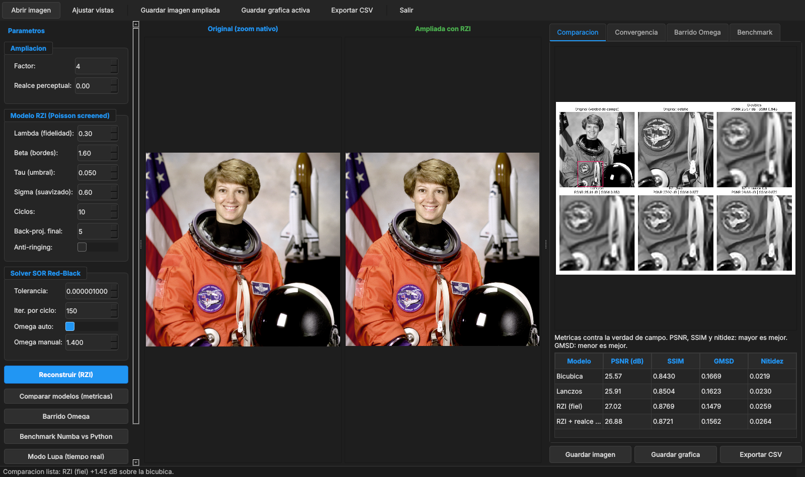{width=100%}

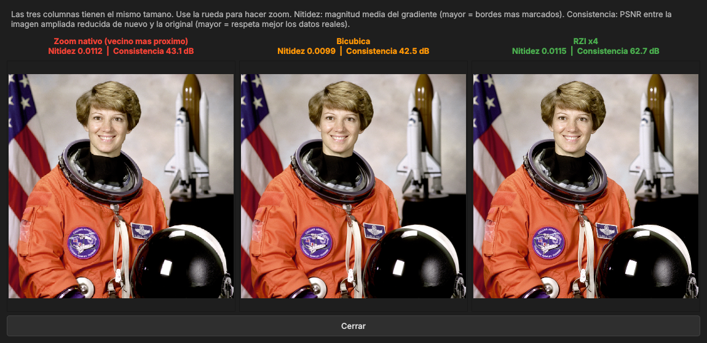{width=100%}

## 12.2 Preguntas probables y respuestas cortas

**1. Por que no usaron inteligencia artificial?**
Porque el objetivo del curso son los metodos numericos. Ademas, RZI no necesita datos de entrenamiento ni GPU, es explicable linea por linea y no inventa detalle falso.

**2. Que es la ecuacion de Poisson y por que sirve para imagenes?**
$\nabla^2 u = g$. Dice como se curva la imagen en cada punto. Si $g$ viene de una guia, la solucion copia la forma de la guia respetando los pixeles fijos.

**3. Por que el signo menos en $b$?**
Porque el solver resuelve $(-\nabla^2)\,u = b$ (diagonal positiva, 4). Para que $u$ siga a la guia hay que poner $b = -\nabla^2 G$. Con el signo al reves la solucion se aleja de la guia; lo comprobamos midiendo.

**4. Que es SOR y por que no Jacobi o Gauss-Seidel?**
SOR es Gauss-Seidel con el paso multiplicado por $\omega$. Con el $\omega$ optimo necesita muchas menos iteraciones. Jacobi es el mas lento; Gauss-Seidel es SOR con $\omega = 1$.

**5. Que aporta el ordenamiento Rojo-Negro?**
Que todos los pixeles de un color se pueden actualizar a la vez, porque solo dependen del otro color. Eso permite paralelizar sin errores.

**6. Como eligen omega?**
Con la formula de Young, $\omega = 2/(1+\sqrt{1-\rho_J^2})$. En el problema con mascara $\rho_J$ se estima con el metodo de la potencia; en el modelo RZI se usa la formula exacta de una malla rectangular con $\lambda$.

**7. Por que la formula clasica de omega fallaba?**
Porque supone que todos los pixeles interiores son incognitas. Los pixeles fijos dentro de la malla la parten en celdas pequenas y reducen el radio espectral.

**8. Que significa matrix-free?**
Que la matriz $A$ nunca se guarda. El estencil de 5 puntos se aplica directamente sobre la imagen. Con $A$ completa, una imagen de 512 x 512 ocuparia unos 550 GB.

**9. Por que el sistema tiene solucion unica?**
La matriz es simetrica y definida positiva (diagonalmente dominante con al menos un pixel fijo, o con $\lambda > 0$). Eso garantiza solucion unica y convergencia de SOR para $0 < \omega < 2$.

**10. Que hace la back-projection?**
Corrige la imagen grande con el error que aparece al volver a achicarla: $t = u + \text{Up}(f - \text{Down}(u))$. Garantiza que el resultado respete la imagen original.

**11. Para que sirve entonces la ecuacion de Poisson si ya hay back-projection?**
La back-projection sola deja ondas (ringing) junto a los bordes. La Poisson screened las limpia y refuerza los bordes reales. Juntas dan mejor resultado que cada una por separado.

**12. Que es $\lambda$?**
El peso de "no alejarse de $t$". Con $\lambda$ grande manda $t$; con $\lambda$ pequeno manda el campo de gradientes. Ademas $\lambda$ en la diagonal acelera la convergencia.

**13. Que hacen $\beta$ y $\tau$?**
$\beta$ es cuanto se refuerzan los bordes fuertes (1 = nada). $\tau$ es el umbral que separa "borde" de "ruido": por debajo de $\tau$ casi no se amplifica.

**14. Que es Numba y cuanto acelera?**
Un compilador JIT que traduce funciones de Python a codigo maquina. Con el mismo trabajo, unas 400 a 550 veces mas rapido en nuestras pruebas.

**15. Como saben que la mejora es real y no solo "se ve mas nitido"?**
Por el protocolo de verdad de campo: tenemos la imagen original y medimos PSNR, SSIM y GMSD. RZI gana en las 12 combinaciones probadas.

**16. Que significa +1 dB de PSNR?**
Que el error cuadratico medio baja aproximadamente un 21 %.

**17. Por que la imagen chelsea mejora menos?**
Porque es muy suave (pelaje desenfocado, pocos bordes). RZI mejora sobre todo los bordes; si hay pocos, hay menos que ganar.

**18. Que pasa con imagenes a color?**
Se separa brillo (Y) y color (Cb, Cr). El brillo pasa por RZI y el color por bicubica con back-projection, porque el ojo percibe la nitidez en el brillo.

**19. Cual es la complejidad del metodo?**
Cada iteracion SOR recorre todos los pixeles una vez: es lineal en el numero de pixeles, $O(N)$. El total es $O(N \cdot \text{ciclos} \cdot \text{iteraciones por ciclo})$; en la practica unas 160 iteraciones en total.

**20. Que mejorarian con mas tiempo?**
Estimar el nucleo de degradacion de cada imagen, usar multigrid para converger aun mas rapido, y un modo especifico para imagenes con ruido.

## 12.3 Errores a evitar en la sustentacion

- No decir que el metodo "recupera" detalles perdidos: reconstruye mejor los bordes.
- No decir que el omega teorico de malla completa coincide con el empirico: ya demostramos que no (y por que).
- No confundir el realce perceptual (opcional, para el ojo) con la mejora del modelo (medida con metricas).
- No prometer resultados de IA: comparar con la bicubica y Lanczos, que son la referencia justa.
- Tener la aplicacion abierta y el kernel de Numba ya compilado antes de empezar (la primera ejecucion tarda unos segundos extra).

## 12.4 Glosario rapido

- **Back-projection:** correccion iterativa con el error al volver a achicar la imagen.
- **Dirichlet (condicion de):** valor fijo en ciertos puntos de la malla.
- **EDP:** ecuacion diferencial parcial (con derivadas en varias direcciones).
- **Estencil:** patron de vecinos que se usa para aproximar una derivada.
- **Factor:** cuantas veces se agranda cada lado de la imagen.
- **Gradiente:** direccion y tamano del cambio de brillo; grande en los bordes.
- **JIT:** compilacion "justo a tiempo", al momento de ejecutar.
- **Laplaciano:** suma de segundas derivadas; mide si un punto es pico, valle o zona lisa.
- **Matrix-free:** resolver sin guardar la matriz.
- **Radio espectral:** el mayor autovalor en valor absoluto; controla la velocidad de convergencia.
- **Residuo:** cuanto falla la ecuacion con la estimacion actual.
- **Ringing:** ondas o halos junto a los bordes.
- **SOR:** sobre-relajacion sucesiva.
- **Verdad de campo:** la imagen original contra la que se compara.

## 12.5 Hoja de formulas

| Concepto | Formula |
|:---|:---|
| Laplaciano discreto | $\nabla^2 u \approx u_{i-1,j} + u_{i+1,j} + u_{i,j-1} + u_{i,j+1} - 4u_{i,j}$ |
| Poisson (problema clasico) | $4u_{i,j} - \sum \text{vecinos} = b_{i,j}$, con $b = -\nabla^2 G$ |
| Paso SOR | $u \leftarrow u + \omega\,(u^{\text{GS}} - u)$ |
| Omega de Young | $\omega_{\text{opt}} = 2 / \left(1 + \sqrt{1 - \rho_J^2}\right)$ |
| Malla completa | $\rho_J = \cos\left(\pi/(n+1)\right)$ |
| Malla rectangular con $\lambda$ | $\rho_J = \left[2\cos\left(\frac{\pi}{m+1}\right) + 2\cos\left(\frac{\pi}{n+1}\right)\right] / (4 + \lambda)$ |
| Back-projection | $t = u + \text{Up}\left(f - \text{Down}(u)\right)$ |
| Energia RZI | $E(u) = \lambda \lVert u - t \rVert^2 + \lVert \nabla u - \mathbf{v} \rVert^2$ |
| Poisson screened | $(4 + \lambda)u_{i,j} - \sum \text{vecinos} = -\operatorname{div}(\mathbf{v}) + \lambda t$ |
| Amplificacion | $s(x) = 1 + (\beta - 1)\,x/(x + \tau)$ |
| PSNR | $10 \log_{10}(1/\text{MSE})$ |

# 13. Arquitectura del software

El codigo esta organizado en tres capas. Cada capa solo usa a la de abajo:

| Capa | Carpeta | Contenido |
|:---|:---|:---|
| 1. Interfaz | `ui/` | Ventana PySide6, visores con zoom sincronizado, hilos de calculo (`QThread`) para no congelar la ventana. |
| 2. Nucleo matematico | `core/` | `poisson_builder.py` (construccion de los problemas y omega), `sor_solver.py` (kernels SOR Red-Black con Numba), `upscaler.py` (modelo RZI), `image_ops.py` (reescalado y color en `float64`). |
| 3. Servicios | `services/` | `metrics.py` (PSNR, SSIM, GMSD, nitidez, protocolo de degradacion), `exporter.py` (CSV y graficas). |

Ademas:

- `tests/`: 15 pruebas automaticas (matematica, solver, modelo, CSV e interfaz).
- `scripts/generar_resultados.py`: reproduce todas las tablas y figuras de este documento.
- `docs/estudio/`: la fuente de este documento y el script que genera el PDF.

**Como ejecutar:**

```
pip install -r requirements.txt
python main.py
python -m pytest tests
python scripts/generar_resultados.py
```

# Referencias

- Young, D. M. (1971). *Iterative Solution of Large Linear Systems*. Academic Press.
- Burden, R. L. y Faires, J. D. *Analisis Numerico*. Cengage Learning (capitulos de metodos iterativos y EDP).
- Irani, M. y Peleg, S. (1991). Improving resolution by image registration. *CVGIP: Graphical Models and Image Processing*, 53(3).
- Perez, P., Gangnet, M. y Blake, A. (2003). Poisson image editing. *ACM SIGGRAPH*.
- Bhat, P., Curless, B., Cohen, M. y Zitnick, C. L. (2008). Fourier analysis of the 2D screened Poisson equation for gradient domain problems. *ECCV*.
- Fattal, R. (2007). Image upsampling via imposed edge statistics. *ACM SIGGRAPH*.
- Wang, Z., Bovik, A. C., Sheikh, H. R. y Simoncelli, E. P. (2004). Image quality assessment: from error visibility to structural similarity. *IEEE Transactions on Image Processing*.
- Xue, W., Zhang, L., Mou, X. y Bovik, A. C. (2014). Gradient magnitude similarity deviation. *IEEE Transactions on Image Processing*.
- Lam, S. K., Pitrou, A. y Seibert, S. (2015). Numba: a LLVM-based Python JIT compiler. *LLVM-HPC Workshop*.
