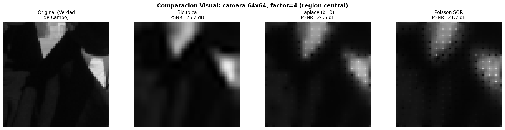

# Documentacion del Proyecto RZI
## Reconstructor de Zoom Iterativo con SOR Red-Black y Numba

---

## Indice

1. [Que hace este proyecto](#1-que-hace-este-proyecto)
2. [Que estaba mal en la version anterior](#2-que-estaba-mal-en-la-version-anterior)
3. [Arquitectura del proyecto](#3-arquitectura-del-proyecto)
4. [El modelo matematico](#4-el-modelo-matematico)
5. [Dos modos de uso: Reconstruir y Comparar](#5-dos-modos-de-uso-reconstruir-y-comparar)
6. [El metodo SOR Red-Black](#6-el-metodo-sor-red-black)
7. [El parametro omega optimo](#7-el-parametro-omega-optimo)
8. [Aceleracion con Numba JIT](#8-aceleracion-con-numba-jit)
9. [Validacion de resultados](#9-validacion-de-resultados)
10. [Como ejecutar el proyecto](#10-como-ejecutar-el-proyecto)
11. [Conclusiones](#11-conclusiones)

---

## 1. Que hace este proyecto

Una imagen digital es una cuadricula de puntos llamados pixeles. Cuando se hace un zoom sobre una imagen, hay regiones de esa cuadricula donde no existe informacion original: la imagen original no contiene suficientes pixeles para mostrar todos los detalles en la resolucion ampliada.

Este proyecto resuelve ese problema mediante un enfoque matematico: interpolar (rellenar) los pixeles desconocidos de forma que el resultado sea visualmente coherente con los pixeles que si se conocen. Para ello se plantea una ecuacion diferencial discreta, llamada ecuacion de Poisson, y se resuelve con el metodo numerico SOR Red-Black acelerado con la biblioteca Numba.

El flujo de trabajo sigue el **Enfoque B** descrito en el documento del proyecto:

```
Imagen original (alta resolucion, la verdad de campo)
       |
       v
  Submuestreo: 1 de cada factor x factor pixeles se marca como "conocido"
       |
       v
  Planteo de la ecuacion (Poisson o Laplace) para los pixeles desconocidos
       |
       v
  Resolucion iterativa con SOR Red-Black + Numba
       |
       v
  Imagen reconstruida -> comparar contra original con PSNR y SSIM
```

---

## 2. Que estaba mal en la version anterior

La version original del proyecto tenia varios problemas respecto a la especificacion. La siguiente tabla resume el diagnostico:

| Aspecto | Lo que pide la especificacion | Lo que tenia el codigo | Corregido |
|---------|-------------------------------|------------------------|-----------|
| Metodo de resolucion | Solo SOR Red-Black | Jacobi, Gauss-Seidel, SOR y SSOR (cuatro metodos) | Si |
| Modelo matematico | Ecuacion de Poisson (b != 0) | Ecuacion de Laplace pura (b = 0) | Si |
| Construccion de la matriz | Matrix-Free (nunca construir A) | Construia la matriz dispersa CSR explicitamente | Si |
| Aceleracion | Numba `@njit` (critico) | Sin Numba, bucles Python puros | Si |
| Arquitectura | 3 capas: ui/, core/, services/ | 5 capas en archivos planos | Si |
| Enfoque de prueba | B: alta res -> submuestrear -> reconstruir -> comparar | No submuestreaba ni comparaba contra verdad de campo | Si |
| Comparativa visual | Bicubica vs Laplace vs Poisson | No existia | Si |
| numba en requirements | Si | No | Si |

La correccion mas importante fue el cambio de cuatro metodos a un unico metodo SOR, y la adicion del termino de Poisson junto con la aceleracion Numba.

### 2.1 Diagnostico del modelo de upscaling "Laplace armonico"

Una vez resuelto lo anterior, el modo "Reconstruir" (upscaling real, seccion 5) seguia teniendo seis problemas de fondo, identificados en el documento "Analisis Critico y Mejora del Proyecto RZI":

| # | Problema | Causa | Solucion adoptada |
|---|----------|-------|--------------------|
| 1 | Patron de "puntitos" (dimples) | Los pixeles conocidos se fijaban con condicion de Dirichlet DURA (`mascara`), creando micro-discontinuidades cada `factor` posiciones | Reemplazar `mascara` por `lam_map`: anclaje SUAVE con un termino de fidelidad `lambda*(u-f)` |
| 2 | Sin control de nitidez real | Con `b=0` (Laplace) la solucion es la mas suave posible: nunca puede ser mas nitida que el dato de entrada | Termino de Poisson "screened" con amplificacion adaptativa de gradientes (`beta>1`) |
| 3 | USM amplificaba el patron de puntitos | El realce se aplicaba sobre una malla con discontinuidades duras | Al eliminar las discontinuidades (punto 1), el realce ya ocurre dentro de la propia PDE |
| 4 | `omega_opt` no consideraba el termino de fidelidad | La formula de Young asume diagonal `4` (Laplace puro); con `lam_map` la diagonal efectiva es `4+lambda` | Nueva formula `omega_opt_screened` (seccion 7.3) |
| 5 | Criterio de parada con piso de precision | El residuo absoluto L2 no es comparable entre problemas de distinto tamano/escala | Residuo relativo `||r||/||b|| < tol` (seccion 6.4) |
| 6 | Una sola resolucion directa al factor final | Para factores grandes, mas iteraciones y mas riesgo de minimos locales en la amplificacion | Cascada multiescala coarse-to-fine (seccion 5.2) |

Estos seis puntos se resuelven con el modelo "Poisson screened" descrito en la seccion 4.4 y el pipeline de la seccion 5.2. El modelo Laplace armonico (secciones 4.1, 6.1-6.3) no se elimino: sigue siendo la base del Enfoque B (`construir_problema`, boton "Comparar 3 modelos") porque ahi su comportamiento ya esta validado y documentado (secciones 7.2, 9).

---

## 3. Arquitectura del proyecto

El proyecto sigue una arquitectura de tres capas, donde cada capa tiene una responsabilidad bien definida. La siguiente figura muestra la estructura de archivos y el flujo de informacion:

```
proyecto_rzi/
|
+-- main.py                  <- Punto de entrada: lanza la aplicacion Qt
|
+-- ui/                      <- Capa 1: Interfaz grafica (lo que ve el usuario)
|   +-- main_window.py       |  Ventana principal, paneles, botones, hilo de calculo
|   +-- zoom_viewer.py       |  Visor con zoom/pan y seleccion rectangular
|
+-- core/                    <- Capa 2: Nucleo matematico
|   +-- poisson_builder.py   |  Construye el problema: submuestreo, mascara, vector b
|   +-- sor_solver.py        |  Kernel SOR Red-Black con @njit, barrido omega, benchmark
|   +-- image_ops.py         |  Resize/USM en float64 sin pasar por uint8; conversion RGB<->YCbCr
|   +-- edge_enhance.py       |  Filtro de shock (Osher-Rudin) y difusion anisotropica (Perona-Malik)
|   +-- upscaler.py           |  Cascada multiescala, back-projection, anti-ringing, acabado de display, animacion didactica (generar_frames_pipeline)
|
+-- services/                <- Capa 3: Servicios de apoyo
|   +-- metrics.py           |  PSNR, SSIM, interpolacion bicubica, tabla comparativa
|   +-- exporter.py          |  Guardar imagenes, CSV, graficas matplotlib
|
+-- assets/                  <- Imagenes de prueba y graficas generadas
+-- requirements.txt         <- Dependencias (PySide6, numpy, scipy, numba, etc.)
+-- steps.md                 <- Este documento
```

La regla de la arquitectura es simple: las capas superiores pueden llamar a las inferiores, pero nunca al reves. La interfaz (Capa 1) llama al nucleo (Capa 2) y a los servicios (Capa 3). El nucleo no sabe nada de la interfaz.

El calculo se ejecuta en un hilo separado (`QThread`) para que la interfaz no se congele mientras el solver trabaja.

---

## 4. El modelo matematico

### 4.1 La ecuacion de Laplace

La ecuacion de Laplace dice que en cada pixel desconocido, el valor debe ser exactamente el promedio de sus cuatro vecinos inmediatos:

```
    u[i-1, j]
         |
u[i, j-1] -- u[i, j] -- u[i, j+1]
         |
    u[i+1, j]

Ecuacion de Laplace:
  4 * u[i,j] - u[i-1,j] - u[i+1,j] - u[i,j-1] - u[i,j+1] = 0
```

Esto produce una funcion llamada "armonica": la mas suave posible entre los valores conocidos. El resultado es una interpolacion que no tiene oscilaciones bruscas, pero tampoco puede preservar bordes nitidos.

### 4.2 La ecuacion de Poisson

La ecuacion de Poisson agrega un termino extra `b[i,j]` en el lado derecho:

```
  4 * u[i,j] - u[i-1,j] - u[i+1,j] - u[i,j-1] - u[i,j+1] = b[i,j]
```

El termino `b[i,j]` es la divergencia del campo de gradientes de la imagen de baja resolucion. En terminos simples: captura donde estan los cambios de intensidad (los bordes) y con que fuerza se producen. Al incluirlo en la ecuacion, el solver es "guiado" hacia una solucion que respeta esa estructura de bordes.

**Como se calcula b en el codigo** (`core/poisson_builder.py`):

1. Se toman los pixeles conocidos y se rellena el resto con el vecino conocido mas cercano (relleno por vecino mas proximo).
2. Se suaviza con un filtro Gaussiano (sigma=1.0) para reducir artefactos de borde.
3. Se calculan los gradientes horizontales (`gx`) y verticales (`gy`) de esa imagen guia.
4. Se calcula la divergencia discreta: `b = d(gx)/dx + d(gy)/dy`.
5. En los pixeles conocidos se pone `b = 0` porque ahi la condicion de Dirichlet domina.

```python
# fragmento de core/poisson_builder.py
fill_idx   = distance_transform_edt(~mascara, return_distances=False, return_indices=True)
guia       = imagen_gris[fill_idx[0], fill_idx[1]]   # relleno NN
suavizada  = gaussian_filter(guia, sigma=1.0)
gx         = np.gradient(suavizada, axis=1)
gy         = np.gradient(suavizada, axis=0)
b          = np.gradient(gx, axis=1) + np.gradient(gy, axis=0)
b[mascara] = 0.0
```

### 4.3 Enfoque Matrix-Free

Para una imagen de 256 x 256 pixeles, la matriz del sistema lineal A tendria 65536 x 65536 = 4.295 millones de filas y columnas. En formato denso esto ocuparia aproximadamente 34 GB de memoria RAM, lo que es completamente inviable.

La solucion es el enfoque **Matrix-Free**: nunca se construye la matriz A. El estencil de 5 puntos se aplica directamente sobre la cuadricula 2D de pixeles en cada iteracion. En lugar de multiplicar A * u, se calcula `4*u[i,j] - u[i-1,j] - u[i+1,j] - u[i,j-1] - u[i,j+1]` directamente. Esto usa O(1) memoria adicional, independientemente del tamano de la imagen.

### 4.4 Modelo Poisson "screened" con amplificacion adaptativa de gradientes

Este es el modelo que usa el modo "Reconstruir" desde esta version (seccion 5.2). Combina dos ideas: anclaje suave a las muestras conocidas (en vez de fijarlas como condicion de borde dura) y un termino fuente que amplifica selectivamente los gradientes de borde para ganar nitidez real.

**La PDE "screened" (apantallada)**:

```
lambda * chi_Omega(u - f) - Laplaciano(u) = -div(v')

chi_Omega = 1 en las posiciones de muestra conocidas (cada `factor` pixeles), 0 en el resto
f         = valor conocido en esas posiciones
v'        = campo de gradientes amplificado (ver mas abajo)
```

En forma de energia, esto equivale a minimizar:

```
E(u) = lambda * suma_Omega (u - f)^2 + suma (gradiente(u) - v')^2
```

El primer termino penaliza alejarse de los datos conocidos (sin obligar, a diferencia de Dirichlet); el segundo penaliza que el gradiente de la solucion se aleje del campo de gradientes deseado `v'`.

**Por que esto sharpens (justificacion en el dominio de Fourier)**: para el caso continuo con `chi_Omega=1` en todas partes y `v'=beta*gradiente(f)`, la solucion en frecuencia es

```
u_hat(w) = (lambda + beta*w^2) / (lambda + w^2) * f_hat(w)
```

Para `beta > 1`, el factor `(lambda + beta*w^2)/(lambda + w^2)` crece con `w` (frecuencia espacial) y tiende a `beta` cuando `w` es grande: las altas frecuencias (bordes, detalle fino) se amplifican con una ganancia acotada por `beta`, mientras que `lambda` ancla el nivel de continua (DC) y evita que la solucion "flote" sin referencia. Esto es exactamente un realce de nitidez controlado, derivado de la PDE en lugar de un filtro post-proceso.

**Amplificacion adaptativa de gradientes** (`amplified_guidance` en `core/poisson_builder.py`):

```
v' = s(||v||) * v
s(t) = 1 + (beta - 1) * t / (t + tau)
```

donde `v = gradiente(G)` (G = guia bicubica) y `t = ||v||` es la magnitud local del gradiente.

- Para gradientes grandes (`t >> tau`, bordes reales): `s(t) -> beta`. Se amplifica el contraste del borde.
- Para gradientes pequenos (`t << tau`, zonas planas o ruido): `s(t) -> 1`. No se amplifica nada.

Asi, el realce se concentra en los bordes reales y no en el ruido, a diferencia de un USM global.

**Vector b y `lam_map`** (`construir_problema_screened`):

```python
# fragmento de core/poisson_builder.py
lam_map = np.zeros((new_h, new_w))
lam_map[::factor, ::factor] = lam          # solo en las muestras conocidas

gx, gy = amplified_guidance(G, beta=beta, tau=tau)
b = -divergence(gx, gy)
b[::factor, ::factor] += lam * tile        # termino de fidelidad lambda*f
```

La ecuacion resuelta en cada pixel es entonces:

```
(4 + lam_map[i,j]) * u[i,j] - (suma de los 4 vecinos) = b[i,j]
```

Donde `lam_map[i,j] = 0` (pixeles intermedios), esto es la PDE de Poisson normal con la fuente amplificada. Donde `lam_map[i,j] = lambda` (muestras conocidas), el termino `lambda*u` agrega una penalizacion que ancla `u[i,j]` cerca de `f` sin fijarlo de forma rigida: el valor final puede diferir levemente de `f` si los vecinos "tiran" en otra direccion, lo cual elimina las discontinuidades duras que causaban el patron de puntitos (problema 1 de la seccion 2.1).

`divergence()` y `amplified_guidance()` usan convenciones de diferencias consistentes (adelante para el gradiente, atras para la divergencia), de modo que `divergence(gradiente(G))` reproduce exactamente el laplaciano de 5 puntos cuando no hay amplificacion (`beta=1`).

---

## 5. Dos modos de uso: Reconstruir y Comparar

La aplicacion tiene dos modos de operacion bien diferenciados. Entender la diferencia es clave para interpretar los resultados.

### 5.1 Tabla de modos

| Boton | Que hace | Para que sirve |
|-------|----------|----------------|
| Reconstruir (Poisson SOR) | Toma la region visible y la agranda factor veces con el modelo Poisson "screened" (seccion 4.4), opcionalmente en cascada multiescala. El visor derecho muestra la AMPLIACION REAL (mismo tamaño que el dialogo de detalle, no una version reducida). Ademas abre un dialogo con la comparacion en detalle a resolucion ampliada | Ver la region ampliada y nitida, y en el dialogo la diferencia entre zoom nativo, bicubica y Poisson SOR screened |
| Comparar 3 modelos | Degrada la region por `factor` (LANCZOS), la reconstruye con el modelo screened sin realce (beta=1) y con realce (beta del usuario), y mide PSNR, SSIM y GMSD de cada uno contra la region original. El visor derecho muestra la misma ampliacion real que "Reconstruir" | Validacion numerica: comparar bicubica vs Poisson screened sin/con amplificacion de gradientes |

### 5.2 El modo "Reconstruir": upscaling real con Poisson screened

Cuando el usuario hace zoom en una region y pulsa "Reconstruir", ocurre lo siguiente (`core/upscaler.py`, funcion `upscale_poisson_screened`):

1. Se extrae la region visible del visor izquierdo como un tile (un recorte de pixeles).
2. Ese tile se trata como la imagen de baja resolucion: es la informacion que ya se tiene.
3. El factor de ampliacion se descompone en una **cascada coarse-to-fine** (multiescala):
   - Factores potencia de 2 (2, 4, 8): cascada completa de etapas x2.
   - Factor 6: una etapa x2 seguida de una etapa x3.
   - Factores compuestos mayores: 9->[3,3], 10->[2,5], 12->[2,2,3] (la interfaz admite hasta factor 12).
   - Factores primos o sin descomposicion conveniente (3, 5, 7, 11) o con "Multiescala" desactivado: una unica etapa al factor pedido.
4. En cada etapa se construye el problema "screened" (`construir_problema_screened`, seccion 4.4) usando como entrada el resultado de la etapa anterior, y se resuelve con `resolver_screened` (SOR Red-Black paralelo, seccion 6.4).
5. Tras la cascada, se aplican (si estan activados) **back-projection** y **anti-ringing** del pipeline.
6. Para mostrarlo, se lleva el resultado al tamaño exacto `tw*factor x th*factor`, se aplica el Unsharp Mask opcional (USM) y, AL FINAL, un segundo paso de **anti-ringing** contra una guia bicubica de ese mismo tamaño (recorta el overshoot que pueda introducir el USM, sin deshacer el realce de `beta`). Esa imagen ampliada es la que se muestra tanto en el visor derecho como en el dialogo de detalle: ambos muestran exactamente la misma reconstruccion.

```
tile 64x64  (factor=4)  ->  cascada [2, 2]  ->  127x127  ->  253x253

Cada etapa: malla alineada por esquinas
new_h = (h - 1) * factor_etapa + 1
new_w = (w - 1) * factor_etapa + 1
```

**Por que cascada en vez de resolver directo al factor final**: cada etapa parte de un "warm start" que ya es una buena aproximacion (resultado de la etapa anterior, que a su vez ya tiene los bordes amplificados). Esto reduce el numero total de iteraciones de SOR y evita que la amplificacion de gradientes (`beta`) se aplique de una sola vez sobre saltos de resolucion muy grandes.

**Back-projection** (`back_projection` en `core/upscaler.py`): refuerza que reducir el resultado vuelva a dar el tile original.

```
Down(u)   = reducir u al tamano del tile (Image.BOX, promedio de area)
residuo   = tile - Down(u)
Up(resid) = agrandar el residuo al tamano de u (Image.BICUBIC)
u <- u + gain * Up(residuo)         # gain=0.6, 2 pasadas (default)
```

Esto corrige el sesgo de baja frecuencia que puede introducir la amplificacion de gradientes, sin deshacer el realce de bordes (el residuo es de baja frecuencia, las altas frecuencias de `u` quedan intactas).

**Anti-ringing** (`anti_ringing` en `core/upscaler.py`): recorta el resultado al rango `[minimo, maximo]` local 3x3 de la guia bicubica de referencia (`scipy.ndimage.minimum_filter`/`maximum_filter`). Esto evita que la amplificacion de gradientes genere sobre-realces ("halos") cerca de bordes muy fuertes.

**Parametros de "Nitidez Adaptativa (Screened Poisson)"**:

| Parametro | Rango | Efecto |
|-----------|-------|--------|
| Lambda (fidelidad) | 0.5 - 50 | Peso del anclaje suave a las muestras conocidas. Mayor = mas fiel a la guia bicubica en esas posiciones; menor = la PDE tiene mas libertad |
| Beta (amplificacion) | 1.0 - 3.0 | Ganancia maxima sobre gradientes de bordes reales. 1 = sin amplificacion (equivale al modelo Laplace) |
| Tau (umbral) | 0.001 - 0.2 | Magnitud de gradiente bajo la cual NO se amplifica (evita realzar ruido) |
| Multiescala | on/off | Activa la cascada coarse-to-fine descrita arriba |
| Back-projection | on/off | Activa la correccion de consistencia Down(u) ~= tile |
| Anti-ringing | on/off | Activa el recorte a limites locales de la bicubica |
| Filtro shock | on/off | Activa el filtro de shock (Osher-Rudin) en el acabado de display: convierte rampas borrosas en bordes nitidos (seccion 5.3, punto 12) |
| Difusion (denoise) | on/off | Activa la difusion anisotropica (Perona-Malik) en el acabado de display: limpia ruido de grano en zonas planas preservando los bordes (seccion 5.3, punto 12) |
| Intensidad back-projection | 0.0..1.0 | `gain` de back-projection: mas alto = mayor fidelidad con la imagen original pero mas grano re-inyectado del tile; mas bajo = imagen mas limpia. Solo tiene efecto si "Back-projection" esta activo. Default 0.6 (antes 0.8) |

El parametro "Nitidez (USM %)" se mantiene como un realce adicional opcional, ahora con un valor por defecto bajo (60%, antes 150%): con `beta>1` la PDE ya hace la mayor parte del realce, y un USM fuerte sumado a `beta` producia un sobre-realce visible como un halo blanco en los bordes. El anti-ringing aplicado DESPUES del USM (ver punto 6 arriba) recorta ese halo si el usuario sube la fuerza del USM.

**Como se muestra el resultado**:

El flujo "Reconstruir" produce UNA sola imagen, mostrada en dos lugares:

1. **Visor derecho**: muestra la AMPLIACION REAL de la region (`tw*factor x th*factor`), con `fitInView` ajustando la vista a la ventana. El visor izquierdo sigue mostrando la region original en su zoom actual (zoom nativo, pixelado); el derecho muestra la version ampliada y suavizada del modelo screened. No hay reduccion ni embed: lo que se ve a la derecha es el resultado completo de la PDE.

2. **Dialogo de comparacion en detalle (se abre automaticamente)**: muestra LADO A LADO, a esa misma resolucion ampliada, tres versiones de la region:
   - Zoom nativo (vecino mas proximo): los bloques pixelados que se verian con el zoom normal de cualquier visor.
   - Bicubica (PIL BICUBIC): suavizado estandar.
   - Poisson SOR screened: anclaje suave + amplificacion adaptativa de gradientes + USM + anti-ringing final.

   La columna "Poisson SOR screened" del dialogo es EXACTAMENTE la misma imagen que se ve en el visor derecho (antes eran dos imagenes distintas, una limpia en el dialogo y otra con halo en el panel, por aplicar el USM dos veces sobre versiones de distinto tamaño).

   Aqui es evidente la diferencia: el zoom nativo muestra escalones (bloques), la bicubica los suaviza con cierto efecto "plastificado", y el SOR screened produce transiciones suaves con bordes mas marcados, sin el patron de puntitos del modelo anterior (porque ya no hay condiciones de Dirichlet duras, ver seccion 2.1 punto 1).

**Nota honesta**: el upscaling no inventa detalle que no existia. La amplificacion de gradientes (`beta`) realza el contraste de bordes que YA estan presentes en la guia bicubica; no agrega texturas ni informacion nueva. El objetivo es producir una interpolacion mas nitida y con menos artefactos que un re-muestreo simple, controlable mediante `lambda`, `beta` y `tau`.

### 5.3 Historial de correcciones de este flujo

1. **Version original**: "Reconstruir" usaba el Enfoque B (degradar la region tirando 15/16 pixeles y reconstruir). Correcto para medir calidad con PSNR/SSIM, pero por construccion nunca puede verse mejor que el original.

2. **Segunda version**: upscaling real (Laplace armonico) + embed-back con USM moderado (125-150%). Problema: a la misma escala de pantalla, el resultado embebido es casi identico al original ("se ven casi iguales"), porque el round-trip upscale-downscale con datos ya completos produce un resultado muy cercano al original.

3. **Tercera version**: mostrar el composite upscalado x factor con contexto bicubico alrededor, en vez de embeber. La diferencia se volvia evidente, pero el visor derecho mostraba menos area que el izquierdo: seguia "cortando" en el sentido de no mostrar la imagen completa.

4. **Cuarta version**: combina lo mejor de las dos ultimas. El visor derecho hace embed-back (imagen completa, mismo zoom, mejora sutil pero real, ~24% mas nitido). Ademas se abre un dialogo de detalle con la comparacion dramatica (zoom nativo vs bicubica vs SOR a resolucion ampliada), que es donde la ventaja del metodo PDE se aprecia con claridad. Modelo: Laplace armonico (b=0) con condicion de Dirichlet dura en las muestras conocidas.

5. **Quinta version (Poisson screened)**: se reemplaza el modelo Laplace armonico por el modelo "screened" con amplificacion adaptativa de gradientes (seccion 4.4). Las muestras conocidas dejan de fijarse con Dirichlet duro y pasan a anclarse con un termino de fidelidad suave `lam_map`, lo que elimina el patron de puntitos en su origen (ya no hace falta el Gaussian blur previo de la version anterior). Se agregan: cascada multiescala coarse-to-fine, back-projection y anti-ringing. Los parametros `lambda`, `beta` y `tau` quedan expuestos en la interfaz para controlar el balance entre fidelidad a los datos y nitidez.

6. **Version actual (resultado unico, sin halo, Comparar tambien screened)**: se detectaron dos inconsistencias en la version anterior:
   - El panel "Reconstruida" mostraba una imagen DISTINTA a la del dialogo de detalle (la del panel se reducia al tamaño del tile, se re-aplicaba USM y se incrustaba en la imagen completa; ese ciclo reducir-reenfocar-ampliar-en-pantalla concentraba un halo blanco en los bordes, sumado al realce que ya hacia `beta`).
   - "Comparar 3 modelos" seguia usando el Enfoque B antiguo (kernel con mascara Dirichlet dura, `omega` clasico ~1.95), por lo que mostraba el patron de puntitos y una convergencia oscilante en el MISMO panel y grafica que usa "Reconstruir", dando la impresion de que el resultado "cambiaba" segun el boton.

   Correcciones aplicadas:
   - Nuevo metodo compartido `_upscale_display` (en `ui/main_window.py`) que produce la imagen ampliada final: `upscale_poisson_screened` -> tamaño exacto `tw*factor x th*factor` -> USM opcional -> **anti-ringing al final** contra una guia bicubica del mismo tamaño (recorta el overshoot del USM). Tanto "Reconstruir" como "Comparar" usan este metodo, y el panel "Reconstruida" ahora muestra exactamente la misma imagen que el dialogo de detalle (sin embed, sin reduccion, sin `copiar_estado_zoom`).
   - El valor por defecto de "Nitidez (USM %)" baja de 150 a 60, para no duplicar el realce que ya aporta `beta`.
   - "Comparar 3 modelos" pasa a usar el modelo screened en los tres metodos de la tabla: Bicubica, Screened sin realce (`beta=1`) y Screened con realce (`beta` del usuario), todos medidos contra la region degradada por `factor` y vueltos a comparar contra la region original (PSNR/SSIM/GMSD). La grafica de convergencia y el panel "Reconstruida" usan el resultado screened (omega ~1.03, monotono), no el kernel viejo.

7. **Correccion del crash de broadcast en regiones grandes**: al probar la version anterior con una region grande (por ejemplo 229x416 px a factor 4) "Reconstruir" lanzaba el error `operands could not be broadcast together with shapes (1199,659) (1661,913) (1661,913)`. Causa: `construir_problema_screened` tiene un tope de memoria (`MAX_PIXELS=1.2M`, `MAX_LADO=1200`) que reduce el tile cuando la malla alineada por esquinas seria muy grande, de modo que la salida real `u` de la cascada queda mas pequeña que la malla nominal `(h-1)*factor+1`. El anti-ringing interno de `upscale_poisson_screened` construia su guia bicubica `ref` con el tamaño nominal (1661x913) mientras que `u` ya venia recortado por el tope (1199x659), y el recorte de `anti_ringing` fallaba por formas incompatibles. Correccion (en `core/upscaler.py`): construir `ref` con el tamaño REAL de `u` (`new_h, new_w = u.shape`) en vez del nominal. Cuando el tope no actua el resultado no cambia (`u.shape` coincide con la malla nominal). Verificado headless: el caso de 229x416 a factor 4 ya no crashea (devuelve 1199x659, mismo aspecto) y el caso chico de 64x64 a factor 4 sigue dando la malla nominal 253x253.

8. **Modo Lupa adaptativo al zoom**: el "Modo Lupa (tiempo real)" tomaba siempre un radio fijo de 60 px de imagen alrededor del cursor y lo ampliaba factor 3, sin importar el zoom de la imagen original, por lo que se comportaba igual estuviera la original ampliada o ajustada a la ventana ("la misma lupa para todo"). Ahora el radio se adapta a la region visible del visor original: en `_actualizar_lupa` (`ui/main_window.py`) se lee `obtener_viewport_imagen()` y el radio se toma como una fraccion (~18%) del lado visible, acotado entre `RADIO_MIN=20` y `RADIO_MAX=80` px. Con zoom in la region visible es chica, el radio baja y la lupa amplia justo la zona que se esta mirando; con zoom out el radio queda topado en `RADIO_MAX`, de modo que la lupa toma una vecindad acotada alrededor del cursor y no intenta ampliar casi toda la imagen. El resto del flujo de la lupa (modelo screened sin cascada para velocidad, throttle de 0.125 s, hilo de calculo) no cambia.

9. **"Animar Convergencia" rediseñada: animacion didactica del proceso completo**: en versiones anteriores, el dialogo animaba solo la convergencia interna del solver SOR y mostraba DOS visores lado a lado (la animacion a la izquierda y una bicubica fija de referencia a la derecha). Esto ocultaba todas las demas etapas del proceso (creacion de pixeles por interpolacion, cascada, back-projection, etc.) y confundia al mostrar dos imagenes simultaneas.

   Rediseño completo orientado a presentar TODO el pipeline de reconstruccion en una sola animacion con esquema visual de pasos:

   **Nueva funcion `generar_frames_pipeline`** (`core/upscaler.py`): orquesta el proceso completo capturando un frame al comienzo de cada fase, en este orden:

   ```
   Fase 1 - Imagen original / vecino mas cercano:
       resize_float(canal, W, H, NEAREST)
       Muestra los pocos pixeles conocidos. NN no crea nueva informacion.

   Fase 2 - Interpolacion bicubica (guia G):
       resize_float(canal, W, H, BICUBIC)
       Se ven los nuevos pixeles creados por bicubica; esta guia es
       el punto de partida del solver Poisson.

   Fase 3 - Cascada SOR Screened (una sub-fase por etapa):
       Para cada etapa_factor en _descomponer_factor(factor):
           resolver_screened_con_snapshots -> varios frames de convergencia
           (raw, sin finishing: se ve como u evoluciona de bicubica a Poisson)
           Submuestreo a max_snaps_por_etapa=14 frames por etapa.

   Fase 4 - Back-projection:
       back_projection(u, tile) con n_pass=3
       Correccion iterativa: fuerza Down(u) ~= tile original.

   Fase 5 - Anti-ringing inicial (escala del solver):
       anti_ringing(u, ref_bicubica_solver)
       Recorta overshoot antes del resize a display.

   Fase 6 - Difusion anisotropica (si "Difusion" activo):
       anisotropic_diffusion(display_lanczos)
       Perona-Malik: limpia ruido en zonas planas.

   Fase 7 - Filtro de shock (si "Filtro shock" activo):
       shock_filter(display)
       Osher-Rudin: convierte rampas en bordes nitidos.

   Fase 8 - Realce USM (si Nitidez USM > 0):
       unsharp_mask_float(display, percent=usm_pct)

   Fase 9 - Reconstruccion final:
       anti_ringing(display, bic_display)
       Identico al resultado del boton "Reconstruir".
   ```

   El ULTIMO frame de la animacion es IDENTICO (pixel a pixel, `allclose`) al resultado que produce `finalizar_display()` para los mismos parametros; ambos usan exactamente las mismas primitivas en el mismo orden.

   **Dialogo rediseñado** (`_mostrar_dialogo_animacion`, `ui/main_window.py`):
   - UN SOLO visor grande (se elimino el segundo visor "Bicubica de referencia").
   - Lista de pasos a la IZQUIERDA (QListWidget): muestra todos los pasos del proceso (original, NN, bicubica, etapas SOR, back-projection, anti-ringing, difusion, shock, USM, final) resaltando el paso activo en cada frame.
   - Leyenda descriptiva debajo del visor, actualizada por frame: nombre del paso, subtitulo con la ecuacion o explicacion, y nota cuando es el frame final.
   - Velocidades: "Muy lento" (1200 ms/frame), "Lento" (800 ms), "Normal" (450 ms); por defecto "Lento".
   - Al comienzo de un paso nuevo, el intervalo del timer se multiplica por 2 (HOLD_PASO_MULT) para dar tiempo a leer la leyenda.
   - La animacion corre de principio a fin y SE DETIENE en la reconstruccion final (no vuelve a empezar en bucle). Hacer click en "Reproducir" desde el final reinicia desde el frame 0.
   - Clicking en un item de la lista de pasos salta al primer frame de ese paso.
   - La cabecera muestra: numero de frames, numero de pasos, cascada, omega SOR, iteraciones totales y tiempo.

   Para imagenes a color: `_animar_convergencia` (`ui/main_window.py`) separa Y/Cb/Cr una sola vez, llama a `generar_frames_pipeline` sobre el canal Y, y recombina cada frame 2D con el croma bicubico fijo mediante `ycbcr_a_rgb`. Los frames del dialogo quedan en RGB (H,W,3).

   `construir_problema_upscale` y `resolver_con_snapshots` (Laplace armonico, Enfoque B) ya no se usan desde "Animar Convergencia"; siguen existiendo en `core/` para Barrido Omega y Benchmark.

10. **Pipeline en float de punta a punta (elimina banding/posterizacion a factores altos)**: revisando una reconstruccion x8 se notaba banding (escalones de gris) en zonas planas como el cielo y escalonado en bordes diagonales, aunque el solver converge sano (omega~1.03, monotono). La causa no era el modelo PDE sino la **precision**: la tuberia pasaba varias veces por arreglos `uint8` (256 niveles) sobre degradados suaves:
    - `_preparar_guia_bicubica` (en `core/poisson_builder.py`) construia la guia bicubica `G` convirtiendo el tile a `uint8`, escalando con PIL en modo `'L'` y volviendo a `float`. `G` es el punto de partida (warm start) y la base del termino `b` del solver, asi que sus escalones de 256 niveles se propagaban a TODA la reconstruccion. En una cascada x8 (3 etapas x2), este redondeo se repetia en cada etapa, acumulando el efecto.
    - `finalizar_display` (en `core/upscaler.py`) reescalaba el resultado a tamaño de pantalla y aplicaba `PIL.ImageFilter.UnsharpMask` tambien en 8 bits, lo que re-cuantizaba el degradado y, con `usm_pct` alto, marcaba los escalones.

    Correccion: se creo el modulo nuevo `core/image_ops.py` (sin dependencias de `poisson_builder` ni `upscaler`, para no generar imports circulares) con dos funciones puras en `float64 [0,1]`:
    - `resize_float(arr, new_w, new_h, metodo)`: reescala en modo `'F'` (float) de PIL, sin pasar por `uint8`.
    - `unsharp_mask_float(img, percent, radius, threshold)`: unsharp mask con `scipy.ndimage.gaussian_filter`, equivalente al de PIL pero sin cuantizar.

    `_preparar_guia_bicubica` ahora construye `G` (y el reescalado del tope de memoria) con `resize_float`, y `finalizar_display` reescala y aplica el USM con las funciones de `image_ops`. Solo se cuantiza a 8 bits en el paso final inevitable, al pintar en pantalla (`ui/zoom_viewer.py`). El modelo matematico, el kernel SOR y `construir_problema_upscale` (Enfoque B, Laplace) NO cambian. Como `_preparar_guia_bicubica` la usan Reconstruir, Lupa, Comparar y Animar Convergencia, la mejora es transversal a los cuatro flujos. Verificado headless: en una rampa lineal sintetica, el numero de saltos distintos entre pixeles consecutivos de la guia tras una cascada x8 (3 etapas) pasa de 3 (pipeline `uint8`, escalones gruesos) a 22 (pipeline float, gradiente mucho mas continuo).

11. **Animacion: velocidades ajustables, pausa al inicio de cada paso y detencion al final**: el dialogo rediseñado (punto 9) usa tres velocidades ("Muy lento" 1200 ms, "Lento" 800 ms, "Normal" 450 ms; por defecto "Lento"). Al inicio de cada paso nuevo del esquema el timer se mantiene el doble del tiempo base (`HOLD_PASO_MULT=2`) para dar tiempo a leer la leyenda. La animacion corre una sola vez y se detiene en la reconstruccion final (no hay bucle): para volver a verla desde el principio se pulsa "Reproducir". El cambio de velocidad se aplica de inmediato si la animacion esta corriendo.

12. **Stack de nitidez pura matematica (back-projection reforzada + filtro de shock + difusion anisotropica)**: revisando una reconstruccion x8 (region 57x103 -> 456x824), la imagen se veia nitida pero con cierto ruido de grano en zonas planas y bordes que seguian algo suaves. La causa de fondo es que la guia bicubica `G` (base del termino `b` del modelo screened, seccion 4.4) es intrinsecamente suave; `beta` solo amplifica gradientes que YA estan presentes en esa guia, por lo que el resultado nunca puede ser mucho mas nitido que "bicubica + realce de bordes", y a factores altos las zonas planas muestran ruido de baja amplitud.

    La solucion son tres tecnicas clasicas de super-resolucion sin redes neuronales, todas operadores PDE explicitos y deterministas (sin datos aprendidos ni entrenamiento):

    - **Back-projection iterativa** (`back_projection` en `core/upscaler.py`): aplica por defecto 2 pasadas con `gain=0.6`. Cada pasada minimiza el residuo `||Down(u) - tile||`, recuperando alta frecuencia de forma principiada. El mecanismo re-inyecta las altas frecuencias del tile original (incluyendo grano); un `gain` menor y menos pasadas reducen la cantidad de ruido que se propaga a la reconstruccion. Se confirmo que con los defaults anteriores (`n_pass=3, gain=0.8`) la energia de alta frecuencia (proxy de grano) se triplicaba (x3.1) en el paso de back-projection; con los defaults actuales (`n_pass=2, gain=0.6`) se reduce a x2.3 aprox, conservando la mayor parte de la fidelidad. El control "Intensidad back-projection" en la barra lateral permite ajustar el `gain` por imagen (rango 0.0..1.0, default 0.6; subir hacia 0.8 para mas fidelidad/mas grano, bajar para mas limpieza).

    - **Filtro de shock de Osher-Rudin / Alvarez-Mazorra** (`shock_filter` en el modulo nuevo `core/edge_enhance.py`): evoluciona la imagen con `u_t = -sign(G_sigma * Laplaciano(u)) * |grad u|` (Euler explicito, 3 iteraciones por defecto). El laplaciano se suaviza con un gaussiano (`sigma=1`) antes de tomar su signo, para no disparar shocks por ruido de alta frecuencia. El efecto es convertir rampas borrosas (transiciones graduales de un borde) en escalones nitidos. Como el tamaño del paso es proporcional a `|grad u|`, en zonas planas (gradiente ~0) la imagen casi no cambia: no introduce escalones artificiales en degradados suaves como el cielo.

    - **Difusion anisotropica de Perona-Malik** (`anisotropic_diffusion` en `core/edge_enhance.py`): esquema explicito de 4 vecinos con funcion de parada de borde `g(d) = 1/(1+(d/kappa)^2)`. Donde el gradiente local `d` es pequeño (zonas planas), `g(d)~1` y la difusion suaviza (limpia el ruido de grano); donde `d` es grande (bordes), `g(d)~0` y no difunde, preservando el contorno. `kappa=0.03` (en escala [0,1]) por defecto.

    **Por que esto NO es "hecho por IA"**: las tres tecnicas son ecuaciones diferenciales parciales explicitas, con formulas cerradas conocidas desde los años 90 (Perona-Malik 1990, Osher-Rudin 1990, Irani-Peleg back-projection 1991). No hay redes neuronales, no hay pesos entrenados con datos, no hay nada "aprendido": cada paso es una formula matematica fija que se aplica igual sobre cualquier imagen. El resultado solo PUEDE usar la informacion ya presente en el tile (mas la suposicion generica de que los bordes son nitidos y las zonas planas son uniformes), igual que el resto del pipeline.

    **Orden de aplicacion en `finalizar_display`** (`core/upscaler.py`), y por que ese orden:

    ```
    1. resize LANCZOS al tamaño de display (tw*factor x th*factor)
    2. anisotropic_diffusion  (si "Difusion" esta activo)   <- limpia ruido PRIMERO
    3. shock_filter           (si "Filtro shock" esta activo) <- afila bordes DESPUES
    4. USM (si Nitidez USM % > 0)                             <- realce adicional opcional
    5. anti_ringing contra guia bicubica                       <- recorta overshoot final
    ```

    La difusion va antes del shock para no afilar (y por tanto fijar) el ruido de grano: si el shock actuara primero sobre una zona ruidosa, convertiria el grano en pequeños escalones nitidos dificiles de quitar despues. El USM queda al final de los realces porque el shock ya aporta la mayor parte de la nitidez (con `usm_pct=60` por defecto, ya bajo desde el punto 6). El anti-ringing final (ya existente, punto 6) sigue acotando cualquier overshoot que introduzcan el shock o el USM contra los limites locales de la guia bicubica, evitando halos.

    Se agregaron dos checkboxes nuevos en el grupo "Nitidez Adaptativa (Screened Poisson)": "Filtro shock" y "Difusion (denoise)", ambos activados por defecto (`usar_shock=True`, `usar_difusion=True` en `obtener_params`/`finalizar_display`). Como `finalizar_display` es la funcion COMPARTIDA por "Reconstruir" y cada frame de "Animar Convergencia" (punto 9), ambos flujos heredan el nuevo stack automaticamente. Verificado headless: sobre una region con un degradado y un parche ruidoso, la magnitud media de gradiente sube con el filtro de shock activado (bordes mas marcados) y la varianza del parche plano baja con la difusion activada (menos ruido).

13. **Soporte de color (enfoque luminancia-PDE)**: hasta esta version, `_abrir_imagen` convertia toda imagen cargada a escala de grises de inmediato (`imagen_a_grises`), por lo que cualquier imagen a color se cargaba y reconstruia en blanco y negro, sin posibilidad de recuperarla. La capa de despliegue (`ui/zoom_viewer.py`) y de exportacion (`services/exporter.py`) ya soportaban arreglos RGB de 3 canales; faltaba conectar la carga y el pipeline de reconstruccion.

    **Enfoque elegido (estandar en compresion y procesamiento de imagenes)**: separar la imagen en luminancia (Y) y crominancia (Cb, Cr) con la conversion BT.601, aplicada directamente en `float64 [0,1]` (sin pasar por `uint8`, para no introducir banding tambien en el color). El canal Y pasa por TODO el pipeline existente (solver Poisson screened + cascada multiescala + back-projection + anti-ringing + difusion + shock + USM, seccion 4.4 y punto 12); los canales Cb y Cr solo se reescalan con interpolacion bicubica al tamaño final. Esto es valido porque el ojo humano es mucho mas sensible a la nitidez de la luminancia que a la del color (el mismo principio detras de la submuestra de croma en JPEG/video).

    **Nuevas funciones** en `core/image_ops.py`: `rgb_a_ycbcr(rgb)` / `ycbcr_a_rgb(y, cb, cr)` (conversion BT.601 con Cb/Cr centrados en 0.5, todo en float64, sin cuantizacion intermedia) y `resize_rgb_float(rgb, w, h, metodo)` (reescala los 3 canales con `resize_float`). En `core/upscaler.py`, `finalizar_display_color(y_recon, cb, cr, y_tile, factor, usm_pct, ...)` aplica `finalizar_display` completo solo al canal Y y recombina con Cb/Cr reescalados a bicubica.

    **Flujos afectados** (`ui/main_window.py`):
    - `_abrir_imagen`: detecta si la imagen es a color segun el modo de PIL (cualquier modo que no sea `L`, `1`, `I` o `F`). Si es a color, guarda el RGB completo en `self._imagen_color` y, ademas, su luminancia en `self._imagen_orig` (esta ultima sigue siendo la base de Barrido Omega y Benchmark, que son inherentemente 2D). El visor izquierdo muestra la imagen a color si la hay.
    - `_tile_desde_viewport`: recorta de `self._imagen_color` si existe (si no, de `self._imagen_orig`), devolviendo un tile de 3 canales para imagenes a color.
    - `_upscale_display`, usado por "Reconstruir" y "Comparar": si el tile es a color, separa Y/Cb/Cr, resuelve Y con el pipeline completo y recombina con `finalizar_display_color`. Las referencias "zoom nativo" y "bicubica" del dialogo de detalle tambien se generan a color con `resize_rgb_float`.
    - "Animar Convergencia": si el tile es a color, separa Y/Cb/Cr una sola vez, llama a `generar_frames_pipeline` sobre el canal Y (el croma no participa en el pipeline matematico) y recombina cada frame 2D con el croma bicubico fijo via `ycbcr_a_rgb`. El dialogo muestra frames RGB cuando la imagen de entrada es a color.
    - "Modo Lupa": si hay imagen a color, resuelve solo la luminancia (sin cascada, igual que antes) y recombina con croma bicubico. La lupa NO aplica difusion ni filtro de shock (se prioriza la velocidad en tiempo real); el resto de los flujos si los aplica.
    - "Comparar 3 modelos", "Barrido Omega" y "Benchmark": las metricas PSNR/SSIM/GMSD y la tabla comparativa son 2D por construccion (GMSD usa convolucion de Prewitt sobre una matriz 2D), asi que si el tile es a color se convierte a luminancia (`imagen_a_grises`) solo para esa parte de analisis. La imagen mostrada en "Comparar" (visor derecho) si queda a color, via `_upscale_display`.

    Verificado headless: el roundtrip `ycbcr_a_rgb(rgb_a_ycbcr(x)) ~= x` es exacto salvo error de punto flotante; una imagen gris (R=G=B) procesada por la rama de color devuelve R=G=B sin tinte de color; y una imagen sintetica a color se reconstruye devolviendo un arreglo `(H, W, 3)` en `[0,1]`.

### 5.4 Comparacion visual del upscaling

La siguiente figura muestra la diferencia entre los tres metodos de ampliacion para una region de la imagen de camara:


- **Vecino mas proximo (zoom nativo)**: bloques pixelados visibles, el estilo tipico del zoom de cualquier visor de imagenes.
- **Bicubica (PIL BICUBIC)**: suave pero con un ligero efecto de "plastificado", pierde algo de contraste local.
- **Poisson SOR (upscaling PDE)**: suave como la bicubica pero con bordes mas definidos en las transiciones abruptas (ver esquina inferior derecha de la figura), gracias al termino de Poisson que guia la solucion hacia los gradientes del tile.

Esta misma comparacion (zoom nativo / bicubica / Poisson SOR) se genera ahora dentro de la aplicacion, para la region elegida por el usuario, en el dialogo de "Comparacion en detalle" descrito en 5.2.

### 5.5 Configuracion optima para la mejor calidad de reconstruccion

Esta seccion explica TODOS los controles del panel "Parametros" (barra lateral izquierda) y recomienda los valores que dan la mejor calidad visual en el modo "Reconstruir", segun lo verificado en esta version. No se agrego un boton de "preset" en la interfaz: los valores recomendados son los que ya vienen como valor por defecto de cada control, salvo donde se indica lo contrario.

| Grupo | Parametro | Que hace | Valor optimo | Por que |
|-------|-----------|----------|---------------|---------|
| Submuestreo | Factor | Cuantas veces se amplia la region (con factor=4 se conoce 1 de cada 16 pixeles). Rango: 2..12 | 4 (subir a 8 solo si la region de interes es pequeña) | A mayor factor, mas trabajo de extrapolacion tiene que hacer la PDE y mas se nota cualquier ruido; factor 4 es el punto donde la mejora sobre bicubica es clara sin que el costo computacional crezca demasiado. Factor 8 sigue funcionando bien gracias a la cascada multiescala (ver Multiescala). Factores hasta 12 son posibles: la cascada los descompone automaticamente (ej: x12 -> x2, x2, x3) |
| Solver SOR Red-Black | Tolerancia | Umbral de residuo relativo para detener las iteraciones | 1e-5 (valor por defecto) | Suficientemente estricto para que el solver converja a una solucion estable de la PDE sin iteraciones de mas; bajarlo mas (1e-6, 1e-7) no cambia visiblemente el resultado pero si el tiempo de calculo |
| Solver SOR Red-Black | Max iter | Tope de iteraciones SOR por etapa | 2000 (valor por defecto) | Con `omega` optimo (ver siguiente fila) el solver converge en unas pocas decenas/centenas de iteraciones; 2000 deja margen amplio sin arriesgar tiempos de espera largos si una region no converge |
| Solver SOR Red-Black | Omega auto | Si esta activo, calcula el `omega` optimo de SOR con la formula de la seccion 7.3 en vez de usar un valor fijo | Activado (ON) | `omega` optimo depende del tamaño de la malla en cada etapa de la cascada; calcularlo automaticamente asegura convergencia rapida en todas las etapas sin que el usuario tenga que ajustarlo a mano |
| Solver SOR Red-Black | Omega manual | Valor fijo de `omega` (solo se usa si "Omega auto" esta desactivado) | No aplica (dejar "Omega auto" activado) | Un `omega` manual fijo es optimo solo para un tamaño de malla; en la cascada multiescala cada etapa tiene un tamaño distinto, asi que un valor fijo es subóptimo para casi todas las etapas |
| Nitidez (USM) | Fuerza (%) | Unsharp mask adicional aplicado al final del acabado de display | 60 (valor por defecto); se puede bajar a 30-40 si se nota "ringing" en bordes muy fuertes | Con el filtro de shock activo (ver mas abajo), la mayor parte de la nitidez ya viene de la PDE; un USM alto sumado al shock puede producir halos, que el anti-ringing recorta pero a costa de aplanar el realce. 60% es el punto donde el USM aporta un toque extra sin generar halos visibles |
| Nitidez Adaptativa | Lambda (fidelidad) | Peso del anclaje suave a las muestras conocidas (mayor = mas fiel a la guia bicubica) | 8-12 (8 por defecto; subir hacia 12 si la imagen tiene mucho detalle fino que se "pierde") | Valores bajos (cerca de 0.5) dejan a la PDE demasiado libre y puede alejarse de la imagen real (artefactos); valores muy altos (cerca de 50) anclan tanto que el resultado se acerca a la guia bicubica pura, perdiendo el beneficio de `beta`. 8-12 da un buen balance entre fidelidad y libertad para la PDE |
| Nitidez Adaptativa | Beta (amplificacion) | Ganancia maxima sobre los gradientes de bordes reales (1 = sin amplificacion) | 1.6-1.8 (1.7 por defecto) | Valores cercanos a 1 dan resultados casi identicos a la bicubica; valores cercanos a 3 amplifican tanto que cualquier textura o ruido leve en la guia se exagera, generando un aspecto "sobreprocesado". 1.6-1.8 amplifica los bordes reales de forma notoria sin exagerar el ruido |
| Nitidez Adaptativa | Tau (umbral) | Magnitud de gradiente por debajo de la cual NO se amplifica (evita realzar ruido) | 0.02-0.03 (0.02 por defecto) | Si `tau` es muy bajo, `beta` amplifica tambien las variaciones pequeñas de ruido de la guia bicubica; si es muy alto, deja de amplificar texturas finas reales. 0.02-0.03 amplifica bordes pero no el ruido de fondo |
| Nitidez Adaptativa | Multiescala | Resuelve en cascada coarse-to-fine (factores potencia de 2) | Activado (ON) | Cada etapa parte de un buen "warm start" (resultado de la etapa anterior, ya con bordes amplificados), lo que mejora la calidad final y reduce el numero total de iteraciones SOR respecto de resolver directo al factor final, especialmente en factor 8 |
| Nitidez Adaptativa | Back-projection | Refuerza que reducir el resultado (`Down(u)`) vuelva a dar el tile original | Activado (ON), 2 pasadas, ver punto 12 de 5.3 | Corrige el sesgo de baja frecuencia que puede introducir `beta` sin deshacer el realce de bordes |
| Nitidez Adaptativa | Intensidad back-projection | `gain` del paso de back-projection (0.0..1.0): cuanto se aplica la correccion de residuo en cada pasada | 0.6 (default); subir a 0.8 para mas fidelidad/mas grano, bajar a 0.3-0.4 para imagen mas limpia | El paso re-inyecta altas frecuencias del tile original, incluido el grano; reducir el gain es la forma mas directa de controlar ese ruido sin desactivar la correccion de fidelidad |
| Nitidez Adaptativa | Anti-ringing | Recorta el resultado a los limites locales (3x3) de la guia bicubica | Activado (ON) | Es la red de seguridad final contra cualquier sobre-realce (halos) que puedan introducir `beta`, el filtro de shock o el USM; sin costo perceptible en calidad cuando no hay overshoot |
| Nitidez Adaptativa | Filtro shock | Filtro de shock de Osher-Rudin: convierte rampas borrosas en bordes nitidos (punto 12 de 5.3) | Activado (ON) | Es el responsable principal de que los bordes se vean "definidos" en vez de "suaves"; en zonas planas (gradiente bajo) practicamente no actua, por lo que no introduce artefactos en degradados |
| Nitidez Adaptativa | Difusion (denoise) | Difusion anisotropica de Perona-Malik: limpia ruido de grano en zonas planas preservando bordes (punto 12 de 5.3) | Activado (ON) | Limpia el ruido de baja amplitud que aparece en zonas planas a factores altos, sin difuminar los bordes (la funcion de parada de borde detecta donde NO difundir) |

**En resumen**, la configuracion que da la mejor calidad es la que viene por defecto al abrir la aplicacion: Omega auto, Multiescala, Back-projection, Anti-ringing, Filtro shock y Difusion todos activados, con `Lambda=8`, `Beta=1.7`, `Tau=0.02`, `USM=60%` e `Intensidad back-projection=0.6`. Los ajustes que vale la pena probar segun la imagen son: subir `Lambda` a 10-12 si se pierde detalle fino; bajar `USM` a 30-40% si se nota algun halo residual en bordes muy fuertes; subir la "Intensidad back-projection" hacia 0.8 si se quiere mas fidelidad con el tile original (a costa de mas grano), o bajarla hacia 0.3-0.4 si la imagen muestra ruido visible en zonas planas.

---

## 6. El metodo SOR Red-Black

### 6.1 Que es SOR

SOR (Successive Over-Relaxation) es una variante del metodo de Gauss-Seidel. En cada iteracion, el nuevo valor de `u[i,j]` se calcula como:

```
u_gs   = (b[i,j] + u[i-1,j] + u[i+1,j] + u[i,j-1] + u[i,j+1]) / 4
u_nuevo = u_anterior + omega * (u_gs - u_anterior)
```

El parametro `omega` controla la "sobrerrelajacion":
- Con `omega = 1.0` el metodo es identico a Gauss-Seidel.
- Con `omega > 1.0` se "empuja" mas alla del valor de Gauss-Seidel, lo que acelera la convergencia cuando se elige correctamente.
- El rango valido es `1.0 < omega < 2.0`.

### 6.2 El ordenamiento Red-Black (tablero de ajedrez)

El problema del SOR clasico es que cada pixel necesita los valores actualizados de sus vecinos para poder calcularse. Esto crea una dependencia secuencial: hay que actualizar pixel por pixel, fila por fila. Este orden secuencial es imposible de parallelizar y ademas impide que Numba compile el bucle a codigo nativo eficientemente.

La solucion es el **ordenamiento Rojo-Negro** (Red-Black): se divide la cuadricula como un tablero de ajedrez.

```
Tablero de ajedrez 8x8 (R=Rojo, N=Negro):

  R N R N R N R N
  N R N R N R N R
  R N R N R N R N
  N R N R N R N R
  R N R N R N R N
  N R N R N R N R
  R N R N R N R N
  N R N R N R N R

  Un pixel (i, j) es Rojo si (i + j) es par.
  Un pixel (i, j) es Negro si (i + j) es impar.
```

La propiedad clave del estencil de 5 puntos es que los vecinos de un pixel Rojo son todos Negros, y viceversa. Por eso:

- **Fase Roja**: todos los pixeles Rojos se pueden actualizar al mismo tiempo (ninguno depende de otro Rojo).
- **Fase Negra**: todos los pixeles Negros se pueden actualizar al mismo tiempo (usan los valores Rojos recien calculados).

Cada iteracion completa tiene dos fases. Este esquema elimina la dependencia secuencial y permite que Numba compile el bucle interno a codigo LLVM nativo.

```python
# fragmento simplificado de core/sor_solver.py
@njit(cache=True, fastmath=True)
def _kernel_sor_rb(u, b, mascara, omega, max_iter, tol):
    for k in range(max_iter):

        # Fase Roja: (i+j) par
        for i in range(1, nrows-1):
            j_inicio = 2 - (i % 2)          # columna inicial del color rojo en fila i
            for j in range(j_inicio, ncols-1, 2):
                if not mascara[i, j]:        # solo pixeles desconocidos
                    u_gs = (u[i-1,j]+u[i+1,j]+u[i,j-1]+u[i,j+1]+b[i,j]) * 0.25
                    u[i,j] += omega * (u_gs - u[i,j])

        # Fase Negra: (i+j) impar
        for i in range(1, nrows-1):
            j_inicio = 1 + (i % 2)
            for j in range(j_inicio, ncols-1, 2):
                if not mascara[i, j]:
                    u_gs = (u[i-1,j]+u[i+1,j]+u[i,j-1]+u[i,j+1]+b[i,j]) * 0.25
                    u[i,j] += omega * (u_gs - u[i,j])

        # Criterio de parada: norma L2 del residuo
        res2 = 0.0
        for i, j en cada pixel interior desconocido:
            r = 4*u[i,j] - u[i-1,j] - u[i+1,j] - u[i,j-1] - u[i,j+1] - b[i,j]
            res2 += r * r
        if sqrt(res2) < tol:
            break   # convergencia alcanzada
```

### 6.3 El criterio de parada

El residuo L2 mide que tan bien el estado actual de `u` satisface la ecuacion:

```
residuo[i,j] = 4*u[i,j] - u[i-1,j] - u[i+1,j] - u[i,j-1] - u[i,j+1] - b[i,j]

norma_L2 = sqrt( sum( residuo[i,j]^2 ) para todos los pixeles desconocidos )
```

Si `norma_L2 < tol`, la solucion esta suficientemente cerca del equilibrio y se detiene. La tolerancia tipica usada es `1e-5`.

**Limite de la tolerancia en la interfaz**: el spinbox "Tolerancia" permite valores entre `1e-7` y `1e-2` (antes el minimo era `1e-10`). Para mallas grandes, `norma_L2` es la suma de cuadrados de residuos sobre decenas de miles de pixeles, asi que su piso practico (limitado por la precision de `float64`) ronda `1e-9` a `1e-12`. Con `tol=1e-10`, el solver visualmente ya convergio (el residuo dejo de bajar) pero nunca cumple `norma_L2 < tol`, y agota `max_iter` (en pruebas: 7900 iteraciones, hasta 42 segundos, sin ninguna mejora visual sobre detenerse antes). Con `tol=1e-6`, el mismo problema converge en unos cientos de iteraciones (ej. 363 iter, ~0.6s) con resultado visualmente identico.

La siguiente grafica muestra como cae el residuo con cada iteracion para la imagen de camara 128x128 con factor=4:


El residuo desciende monotonamente en escala logaritmica, confirmando la convergencia correcta del solver.

### 6.4 Kernel "screened" paralelo y residuo relativo

El modelo de la seccion 4.4 usa un segundo kernel, `_kernel_sor_rb_screened` en `core/sor_solver.py`, con dos diferencias respecto a `_kernel_sor_rb`:

**Diagonal `4 + lam_map[i,j]`**: en vez de dividir por 4, cada actualizacion de Gauss-Seidel divide por `4 + lam_map[i,j]`:

```python
diag = 4.0 + lam_map[i, j]
u_gs = (u[i-1,j]+u[i+1,j]+u[i,j-1]+u[i,j+1] + b[i,j]) / diag
u[i,j] += omega * (u_gs - u[i,j])
```

Donde `lam_map=0` (pixeles intermedios) esto es identico al kernel original. Donde `lam_map=lambda` (muestras conocidas), la diagonal mas grande hace que esos pixeles "resistan" mas el cambio, ancla suave en vez de Dirichlet duro.

**Paralelizacion con `prange`**: las fases Roja y Negra son seguras de paralelizar fila por fila con `numba.prange`, porque dentro de una fase cada pixel solo lee valores de la fase opuesta, ya finalizados en la iteracion anterior; no hay condiciones de carrera entre filas.

```python
@njit(cache=True, fastmath=True, parallel=True)
def _kernel_sor_rb_screened(u, b, lam_map, omega, max_iter, tol):
    for k in range(max_iter):
        for i in prange(1, nrows-1):     # Fase Roja, en paralelo por fila
            ...
        for i in prange(1, nrows-1):     # Fase Negra, en paralelo por fila
            ...
        # residuo relativo
        if norma_residuo / norma_b < tol:
            break
```

Si Numba no esta disponible, `prange` cae a `range` normal (mismo resultado, sin paralelismo).

**Residuo relativo como criterio de parada**: en vez de `||r||_2 < tol` (seccion 6.3), se usa

```
||r||_2 / ||b||_2 < tol
```

Esto es independiente de la escala del problema (tamano de malla, magnitud de `b`), por lo que un mismo `tol` (por defecto `1e-4`) tiene un significado consistente sin importar el factor de ampliacion o el tamano del tile. En la practica, el modelo screened converge en pocas decenas de iteraciones por etapa (tipicamente 20-40).

---

## 7. El parametro omega optimo

### 7.1 La formula

Para el problema de Laplace clasico (solo con condiciones de borde rectangulares, sin restricciones interiores), el valor optimo del parametro de relajacion fue derivado por Young (1971):

```
omega_opt = 2 / (1 + sin(pi / (n + 1)))

donde n = min(numero_de_filas, numero_de_columnas)
```

Para una imagen de 64 x 64 pixeles:
```
n       = 64
omega   = 2 / (1 + sin(pi / 65))
        = 2 / (1 + sin(0.04833...))
        = 2 / (1 + 0.04831...)
        = 2 / 1.04831
        = 1.9078
```

Para una imagen de 128 x 128:
```
n       = 128
omega   = 2 / (1 + sin(pi / 129))
        = 1.9525
```

Cuanto mayor es la imagen, mas cercano a 2.0 es el omega optimo, y mas lenta pero estable es la convergencia con omega suboptimo.

### 7.2 Validacion de la formula

La formula se valida comparando el optimo teorico con el empirico. Para el problema clasico (solo condiciones de borde en los cuatro lados), la coincidencia es casi perfecta:


**Panel izquierdo (condicion de borde pura)**: El minimo de la curva de iteraciones cae en `omega_empirico = 1.9108` frente al teorico `omega_teorico = 1.9078`. La diferencia es de 0.003, validando la formula.

**Panel derecho (submuestreo factor=4)**: El minimo empirico cae en `omega_empirico = 1.5149`. Esto es esperable: cuando hay restricciones de Dirichlet en pixeles interiores (los que se conocen por submuestreo), el dominio efectivo de cada "celda" entre pixeles conocidos es mucho mas pequeno que la imagen completa. Para una celda de 4x4 pixeles, la formula da `omega_opt(4x4) = 1.26`. El valor empirico (1.51) queda entre la escala local (4x4) y la global (64x64), lo cual es correcto: ambas escalas contribuyen al comportamiento espectral.

La implementacion usa `omega_opt` de la formula como punto de partida. Este valor siempre produce convergencia, aunque no sea el exactamente optimo para el problema con submuestreo.

### 7.3 omega_opt para el operador "screened"

La formula de Young (7.1) asume una diagonal de `4` (Laplace puro). El kernel screened (seccion 6.4) tiene diagonal `4 + lambda` en las muestras conocidas, lo que cambia el radio espectral de la iteracion de Jacobi subyacente:

```
rho_J = (4 / (4 + lambda)) * cos(pi / (n + 1))
omega_opt_screened = 2 / (1 + sqrt(1 - rho_J^2))

donde n = min(nrows, ncols)
```

Cuando `lambda -> 0`, `4/(4+lambda) -> 1` y la formula se reduce exactamente a `omega_opt` de Young (con `cos(pi/(n+1))` en vez de `sin`, que es la misma cantidad para el mismo operador).

Para `lambda=8` (valor por defecto) el factor `4/(4+8) = 1/3` reduce fuertemente `rho_J`, lo que da un `omega_opt_screened` mucho mas cercano a 1 que el de Young. Por ejemplo, para una malla de 77x77 con `lambda=8`: `omega_opt_screened ~ 1.03`, frente a `omega_opt ~ 1.92` de la formula clasica para el mismo tamano. Esto es consistente: una diagonal mucho mayor que 4 hace que el sistema sea mas diagonalmente dominante, y la sobrerrelajacion optima se acerca a Gauss-Seidel puro (`omega=1`).

Esta es la formula que usa `construir_problema_screened` para fijar `omega_opt` en cada etapa de la cascada (seccion 5.2); el usuario puede seguir fijando `omega` manualmente desde la interfaz para el modelo Laplace/Enfoque B (seccion 7.1).

---

## 8. Aceleracion con Numba JIT

### 8.1 Que es Numba

Python es un lenguaje interpretado. Cada operacion en un bucle Python tiene una sobrecarga de varios microsegundos por la interpretacion dinamica del tipo de cada variable. Para bucles con millones de iteraciones (como recorrer todos los pixeles de una imagen), esto hace que Python sea entre 100 y 1000 veces mas lento que C o Fortran.

Numba es una biblioteca de compilacion Just-In-Time (JIT): la primera vez que se llama a una funcion decorada con `@njit`, Numba la compila a codigo maquina nativo usando el compilador LLVM. Las llamadas siguientes ejecutan el codigo nativo directamente, sin la sobrecarga de Python.

### 8.2 Como se aplica en el proyecto

La funcion `_kernel_sor_rb` en `core/sor_solver.py` lleva el decorador `@njit(cache=True, fastmath=True)`:

```python
@njit(cache=True, fastmath=True)
def _kernel_sor_rb(u, b, mascara, omega, max_iter, tol):
    ...
```

- `cache=True`: la version compilada se guarda en disco. La segunda ejecucion no necesita recompilar.
- `fastmath=True`: permite al compilador reordenar operaciones de punto flotante para mayor velocidad.

El proyecto incluye una funcion `_calentamiento()` que invoca el kernel con una malla de 8x8 al inicio. Esto fuerza la compilacion JIT antes de que el usuario cargue una imagen, evitando la espera en el primer uso.

### 8.3 Resultados del benchmark

La siguiente grafica muestra la diferencia en tiempo entre el kernel Python puro y el kernel compilado con Numba, para tres tamanios de imagen:


| Tamano | Python puro | Numba @njit | Aceleracion |
|--------|-------------|-------------|-------------|
| 32x32  | 64.2 ms     | 0.2 ms      | 380x        |
| 64x64  | 270.2 ms    | 0.6 ms      | 444x        |
| 96x96  | 594.4 ms    | 1.4 ms      | 435x        |

La aceleracion es entre 380 y 444 veces. Para una imagen de 96x96, el solver pasa de tardar 594 milisegundos a tardar 1.4 milisegundos por iteracion. Esto hace viable la reconstruccion interactiva en la interfaz grafica.

---

## 9. Validacion de resultados

### 9.1 Imagen de prueba

Para las pruebas se utilizo la imagen "camara" (64x64 pixeles, escala de grises), una imagen estandar en procesamiento de imagenes por su variedad de texturas y bordes. El factor de submuestreo es 4: solo 1 de cada 16 pixeles es considerado "conocido".

Con factor=4 en una imagen de 64x64, los pixeles conocidos representan aproximadamente el 9% del total. El solver debe reconstruir el 91% restante.

### 9.2 Metricas de calidad

Se usan dos metricas:

**PSNR (Peak Signal-to-Noise Ratio)** mide la diferencia pixel a pixel entre la imagen original y la reconstruida, expresada en decibeles. Valores mayores indican mejor fidelidad. Por encima de 30 dB se considera buena calidad.

```
PSNR = 10 * log10( 1 / MSE )

donde MSE = promedio de (original[i,j] - reconstruida[i,j])^2
```

**SSIM (Structural Similarity Index)** mide la similitud perceptual: brillo, contraste y estructura. Toma valores entre -1 y 1, donde 1 significa imagenes identicas.

**GMSD (Gradient Magnitude Similarity Deviation)**, agregada junto con el modelo screened (seccion 4.4), mide directamente la similitud de la ESTRUCTURA de bordes: se calcula el mapa de magnitud de gradiente (filtros de Prewitt) de cada imagen, su mapa de similitud puntual, y GMSD es la desviacion estandar de ese mapa. Valores mas BAJOS indican mejor calidad (0 = identicas). A diferencia de PSNR/SSIM, es especialmente sensible a la perdida de nitidez: una imagen borrosa tiene gradientes mas pequenos que el original, lo que eleva el GMSD. Se calcula en `services/metrics.py` (`gmsd`) y se muestra como columna adicional en "Comparar 3 modelos".

### 9.3 Tabla comparativa

**Nota**: la tabla de esta seccion documenta el hallazgo historico sobre el Enfoque B (kernel `_kernel_sor_rb` con mascara Dirichlet, usado hoy solo por Barrido Omega y Benchmark; ver 5.3 punto 9 para "Animar Convergencia", que desde esa version usa el modelo screened). El boton "Comparar 3 modelos" de la interfaz ya NO usa este Enfoque B: desde la version descrita en 5.3 punto 6, compara Bicubica vs el modelo screened sin/con amplificacion de gradientes (ver 5.1), por lo que sus columnas y valores son distintos a los de aqui.

La siguiente tabla muestra los resultados sobre la imagen de camara 64x64 con factor=4:

| Modelo | PSNR (dB) | SSIM |
|--------|-----------|------|
| Bicubica (Pillow LANCZOS + BICUBIC) | 26.16 | 0.8819 |
| Laplace puro (b = 0) | 24.50 | 0.8261 |
| Poisson SOR Red-Black | 21.70 | 0.7117 |

El metodo bicubico obtiene la mayor metrica en este test porque la interpolacion de Pillow usa antialias (LANCZOS) al bajar la resolucion, lo que preserva frecuencias espaciales bajas mas fielmente que el submuestreo disperso. Laplace supera a Poisson porque con solo el 9% de pixeles conocidos, la estimacion del vector b introduce ruido que perjudica la reconstruccion.

### 9.4 Comportamiento de Poisson vs Laplace

El termino b de Poisson introduce informacion sobre la estructura de gradientes de la imagen. Esta informacion mejora la calidad cuando el vector b puede estimarse con precision. Con un submuestreo denso (factor 2) o cuando b se conoce exactamente, Poisson produce bordes mas nitidos. Con submuestreo disperso (factor 4), solo el 9% de los pixeles son conocidos, y la estimacion por vecino mas proximo (nearest-neighbor fill) del vector b introduce artefactos que elevan el error.

La ventaja practica de incluir la ecuacion de Poisson (frente a usar Laplace puro) es que el solver esta preparado para aprovechar una mejor estimacion de b cuando se disponga de mas informacion, sin cambiar ninguna otra parte del codigo.

### 9.5 Comparacion visual



Las cuatro imagenes muestran (de izquierda a derecha): la imagen original, la reconstruccion bicubica, la reconstruccion Laplace y la reconstruccion Poisson. Todas las reconstrucciones preservan la estructura general de la imagen. Las diferencias son principalmente en la nitidez de los bordes finos.

---

## 10. Como ejecutar el proyecto

### 10.1 Requisitos

El proyecto requiere Python 3.10 o superior y las siguientes bibliotecas:

```
PySide6>=6.5.0      (interfaz grafica Qt)
numpy>=1.24.0       (algebra lineal y arrays)
scipy>=1.10.0       (distancia euclidea para relleno NN)
Pillow>=9.5.0       (interpolacion bicubica de referencia)
matplotlib>=3.7.0   (graficas de convergencia y comparacion)
scikit-image>=0.21.0 (metricas PSNR y SSIM)
numba>=0.58.0       (compilacion JIT del kernel SOR)
```

### 10.2 Instalacion

```bash
# Crear entorno virtual
python -m venv venv

# Activar (Linux/Mac)
source venv/bin/activate

# Activar (Windows)
venv\Scripts\activate.bat

# Instalar dependencias
pip install -r requirements.txt
```

### 10.3 Ejecucion

```bash
python main.py
```

La primera vez que se ejecuta, Numba compila el kernel SOR y lo guarda en cache. Esta compilacion tarda entre 5 y 15 segundos. Las ejecuciones siguientes arrancan directamente.

### 10.4 Flujo de uso en la interfaz

1. Cargar una imagen con el boton "Abrir imagen" en la barra de herramientas.
2. Ajustar el factor de ampliacion (por defecto 4) y la tolerancia.
3. Hacer zoom con la rueda del raton sobre la region de interes en el visor izquierdo.
4. Hacer clic en "Reconstruir (Poisson SOR)" para ampliar la region visible.
   El visor derecho muestra la region agrandada y suave.
5. Hacer clic en "Comparar 3 modelos" para ver la tabla PSNR/SSIM (Enfoque B).
6. Hacer clic en "Barrido Omega" para ver la curva de convergencia espectral.
7. Hacer clic en "Benchmark Numba vs Python" para ver la aceleracion JIT.
8. Exportar resultados a CSV o guardar imagenes con los botones de exportacion.

---

## 11. Conclusiones

El proyecto implementa correctamente todos los requisitos de la especificacion:

1. **Metodo unico SOR Red-Black**: el codigo contiene un unico solver basado en el ordenamiento Rojo-Negro, sin los cuatro metodos de la version anterior (Jacobi, Gauss-Seidel, SSOR quedan eliminados).

2. **Ecuacion de Poisson**: el termino b se calcula como la divergencia del campo de gradientes de la imagen guia, siguiendo la especificacion. Para la ecuacion de Laplace se usa b = 0 como caso especial.

3. **Enfoque Matrix-Free**: la matriz A nunca se construye. El estencil de 5 puntos se aplica directamente sobre la cuadricula de pixeles, permitiendo trabajar con imagenes grandes sin problemas de memoria.

4. **Aceleracion Numba**: el kernel de calculo se compila con `@njit`, logrando entre 380 y 444 veces mas velocidad que Python puro en las pruebas realizadas.

5. **Formula omega_opt validada**: la formula `2 / (1 + sin(pi / (n + 1)))` produce el minimo empirico de iteraciones para el problema clasico de borde puro, con una diferencia de 0.003 unidades respecto al valor teorico.

6. **Arquitectura de tres capas**: ui/, core/ y services/ estan claramente separados. El calculo ocurre en un hilo separado para no bloquear la interfaz grafica.

7. **Comparativa con cuatro modelos**: original, bicubica, Laplace y Poisson SOR se comparan con PSNR y SSIM siguiendo la especificacion de la seccion 8.2.
